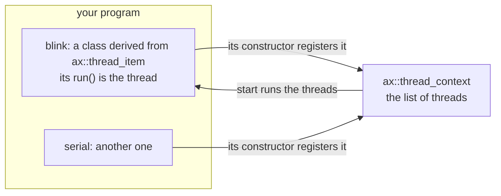
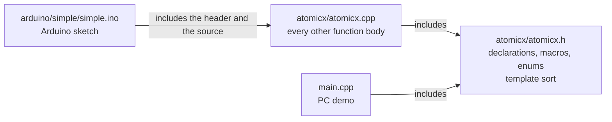
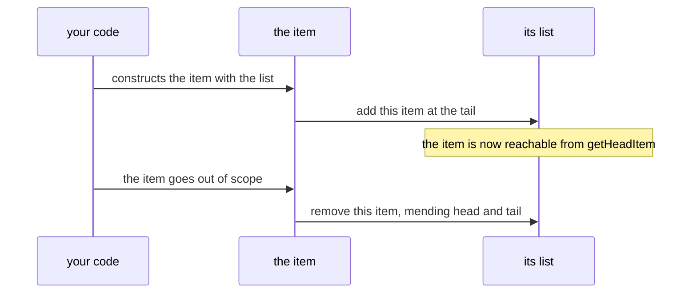
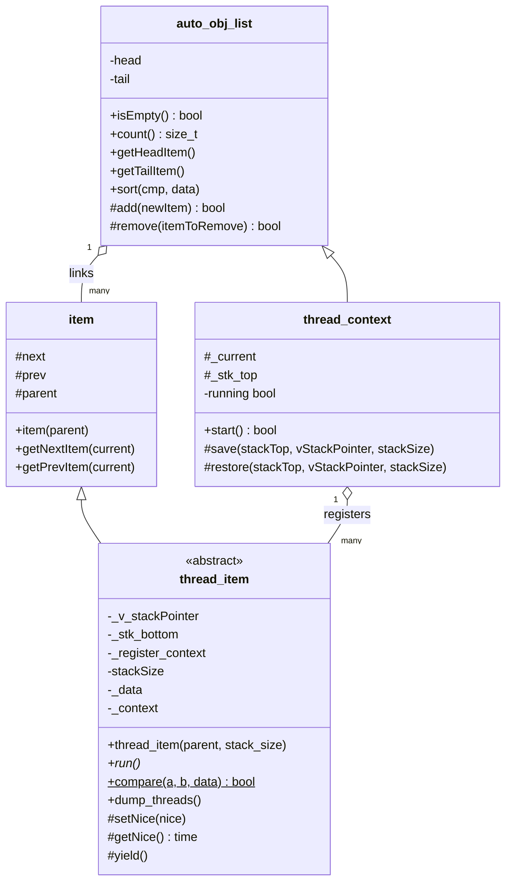
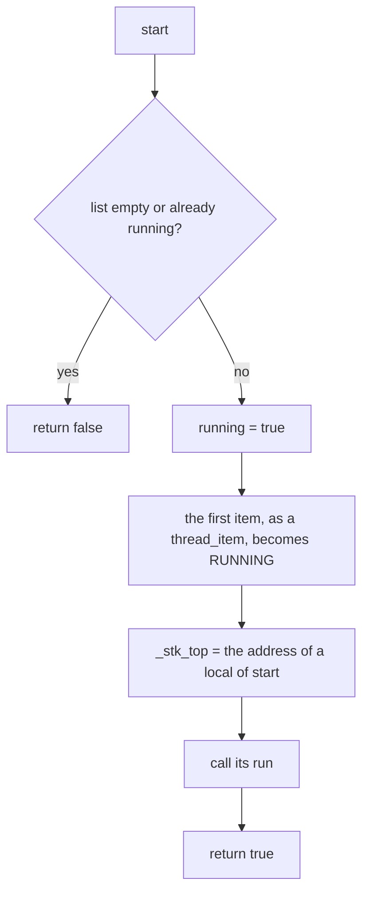
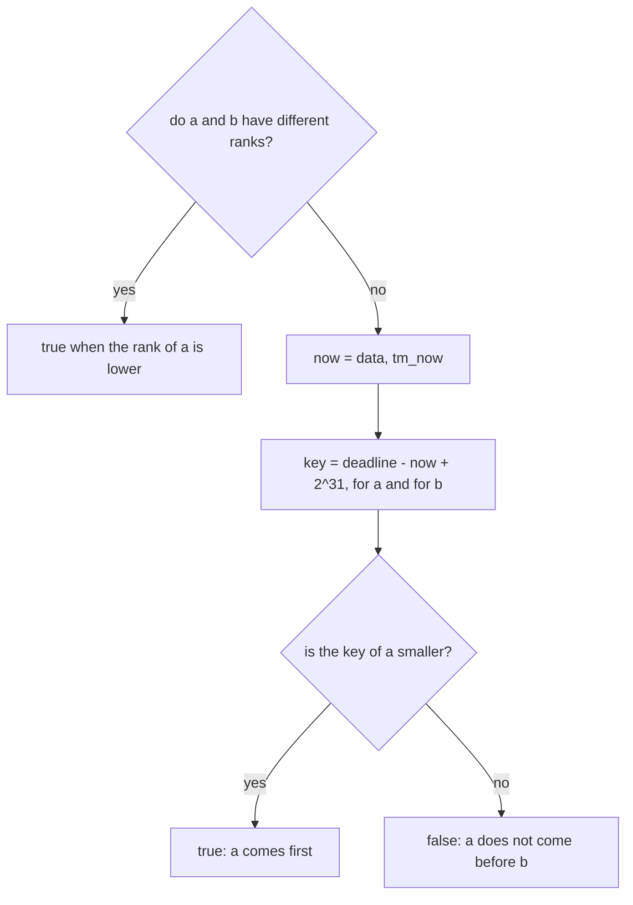
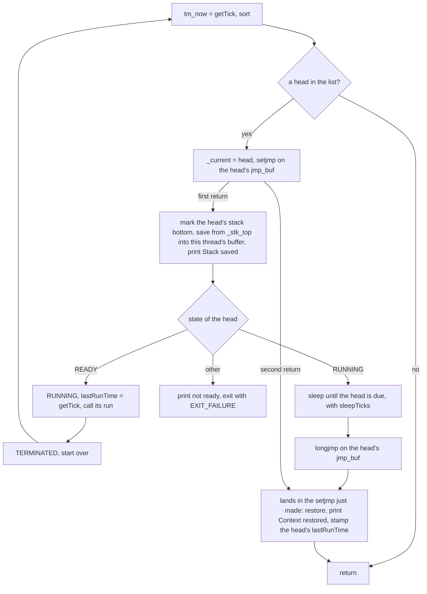
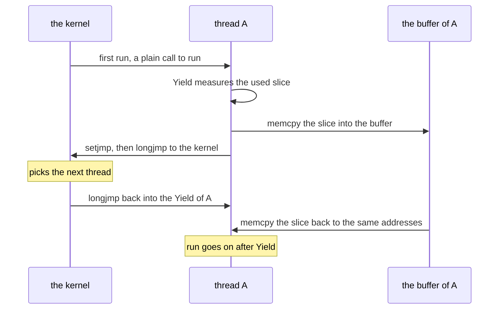

# AtomicX 2 — Specification (SDD), v2.0.0.proto

**What AtomicX 2 is.** AtomicX 2 is a C++11 library for **cooperative multithreading** on small microcontrollers
(AVR such as the Arduino Nano, ESP8266, ESP32, STM32) and on computers (Linux, macOS). *Cooperative* means a thread
runs until it gives the processor back by itself; nothing interrupts it. A thread is an ordinary object: you derive a
class from `ax::thread_item`, write its `run()`, and construct it with an `ax::thread_context`. Constructing the
object registers the thread in the context; destroying it unregisters it; nothing else has to be called. AtomicX 2 is
the successor of atomicx v1.3.0 (github.com/solariun/atomicx), whose threads switch by copying each thread's part of
the stack in and out of a buffer (§3.6).

**Status (2026-10-26): prototype, version `2.0.0.proto`, rebuilt from scratch since 2026-10-09; the last commit is
`f656da0` (2026-10-23), and the changes after it (fewer traces, `getNice()`, eight threads in the demo) are not
committed yet.** Built: the self-registering list
(`auto_obj_list`, with a stable merge sort), threads that register themselves and own a stack buffer
(`thread_item`), the context that holds them (`thread_context`), and the schedule order that ranks them by state and
by time (`thread_item::compare`). In progress: the context switch (`yield()`, `start()`, `save`, `restore`, §3.5), a
first cut of atomicx v1's stack copy that does not switch threads yet: new threads run nested inside the yielding
one, a chosen thread is never resumed, the stack copies cover the wrong range, and a buffer can overflow (P23 to
P27); `yield()` already sleeps until the chosen thread is due (A11). Not built: the `NOW`, `SLEEPING` and `WAITING`
states, which are ranked but never set. Build state: `make build` is clean under `-Werror`; the demo's four threads
loop forever, but only the last one started keeps running (§3.5). For the ESP32 the library compiles, but
`arduino/simple` links only in a copy with `setup()` and `loop()` added (P3); AVR does not compile (P1, P30). The
earlier prototypes (2024) stay in the history; the last one is commit `683195f`.

This file is normative: every change to behaviour, API, file layout or tests is recorded here first (Spec-Driven
Development, §0.3). Where this file and the code disagree, the disagreement is a defect to be resolved here first.

**Repository:** github.com/solariun/atomicx2. **Author:** Gustavo Campos. **License:** undecided (P14).

### Changelog

| Date | Change |
|---|---|
| 2024-02-25 to 2024-09-24 | **Earlier attempts** (`5fd1afe` to `969611b`): a `thread` class that registers itself on a static list (`5fd1afe`); the "first thread engine" (`09bf6dd`, 2024-02-29), in namespace `atomicx`: `setjmp`/`longjmp` with a save and a restore of the stack slice and one global context `g_ctx`; restarted on 2024-09-23 ("new version prototype started", `e1d6c12`) with `Context` and `Thread` classes (`edb369f`), each thread taking its own context and a program-given buffer of `size_t` words (`b834acc`). |
| 2024-09-24 to 2024-11-02 | **The first running prototype** (`8611af1` to `683195f`): threads switched with `setjmp`/`longjmp` and a copy of each thread's used stack slice, as atomicx v1 does; stack buffers given by the program through `VMEM`; a context per thread at first, one global context `ctx` from `9b0ea0d` (namespace `ax` from `ef0b9da`); a scheduler that ran `READY` threads first, then the sleeping thread due first (the "momentum scheduler" of `1539f25`); `wait`/`notify` keyed by a variable's address and a channel, with tags and timeouts, and a system channel 255 (`ATIMICX_SYS_CHANEL`) used inside. A PC demo and an Arduino Nano demo. |
| 2026-10-09 | **Redesign started** (`8607977`, "redesign: initial"): the implementation removed (`atomicx.cpp` reduced to its includes and an empty namespace, 351 lines deleted; 649 lines deleted over five files, the PC demo included); a new skeleton: the self-registering list `auto_obj_list`, `thread_context` objects passed to each `thread_item`, stack buffers on the heap, `enum class State`. The Arduino sketch kept the old API. The header failed `-Werror` (an unused variable). |
| 2026-10-10 | `710c462`: `Time` renamed `time` and `RefId` renamed `ref`; `getNextItem` and `getPrevItem`; the links made protected. The header did not compile (an unfinished struct in `thread_item`). |
| 2026-10-12 | `8eea8f3`: the stable merge sort `auto_obj_list::sort` (no STL, no recursion); `st_data` (`lastRunTime`, `nice`, `state`), which made the header compile again; the stack pointers renamed `_v_stackPointer` and `_l_stackPointer`; the sketch's threads, `setup()` and `loop()` removed. |
| 2026-10-13, `fa67484` | **`start()` runs the first thread** (Gustavo): `thread_context` moved after `thread_item`, hence A4; `start()` returns false when `running` is set and calls the first item's `run()` through a cast to `thread_item*` (R3.9, R3.11, P11), where at `8eea8f3` it ran nothing and returned true on every call; the comment "BY DESIGN would never return…" added (R3.10). |
| 2026-10-13, `fa67484` | **Thread construction fixed (A2, A3, A4).** `class thread_context;` is declared before `thread_item` (Gustavo), and the `thread_item` constructor is defined where `thread_context` is complete, because `item(parent)` must convert `thread_context&` to `auto_obj_list&`. The stack buffer comes from `new (std::nothrow)`, so the failure branch can run on every target; the constructor's parameter is `stack_size`, so `stackSize = 0` resets the member. Measured on the PC: a request of 2^61 bytes aborted the program (`std::bad_alloc`, exit 134) before, and is reported and survived (buffer null, `stackSize` 0, exit 0) after (§6). |
| 2026-10-13, `fa67484` | **Declarations in the header, definitions in the source (A1).** The 15 non-template member function bodies moved from `atomicx.h` to `atomicx.cpp`, in declaration order, their text unchanged (only shifted to namespace level); the template `sort` stays in the header; `#include <new>` moved with the constructor. Proof: the moved bodies byte-identical to Gustavo's working copy, `make build` clean with `-Werror`, the demo's output unchanged. Cost on the ESP32: +184 bytes with the probe sketch of §6, and +251,641 bytes of flash and +7,132 bytes of RAM in a sketch that uses nothing of AtomicX, because the out-of-line definitions bring the C++ stream library in (P17). |
| 2026-10-13, `fa67484` | **`volatile` list changes and a typed parent (A5, Gustavo).** `add` and `remove` became `volatile` member functions, `item::parent` a `volatile auto_obj_list&`, and `thread_item` gained `_parent` (`volatile thread_context&`); the stack buffer is allocated in the initializer list. The initializer list was then written in construction order (R3.1), which `-Werror` requires (`-Wreorder-ctor`). |
| 2026-10-13, `fa67484` | **`thread_item`'s data made private; `yield()` declared (A6, Gustavo).** Every data member of `thread_item` is now private, and a private `void yield()` is declared and defined empty. `make build` then failed under `-Werror`: `-Wunused-private-field` on `_l_stackPointer` and `_parent` (P20); `fa67484` includes this edit, although its message says that `make build` is clean. |
| 2026-10-13, `fa67484` | **This specification created** (the commit holds its first version): the code as built, the earlier history, atomicx v1's thread switch as the reference (§3.6), and the open problems found while writing it (§7), each with the evidence given in its row. Reviewed independently the same day (claims against the code and the history, v1's citations, diagrams, tables and cross-references); its 32 findings corrected in `1245c3b`. |
| 2026-10-14, `1245c3b` | **The schedule order, applied by `yield()` (A7, A8, Gustavo).** `thread_item::compare(a, b, data)`, public and static, orders a context for `sort`: `READY` threads first, then due threads (`lastRunTime + nice` not after now, wrap-safe), ties in list order; now is read once per sort, from `data->_data.tm_now`, which `yield()` sets from `getTick()` before sorting. `sort` became `sort(cmp, data)`, passing `data` to `cmp` as a third argument; `sort` and `count` became `volatile`. `st_data` became public and gained `tm_now`, and starts at `lastRunTime = 0`, `nice = 1` (P6 fixed). `dump_threads()` lists the context's threads; `yield()` became protected; `State` gained `WAITING`; `main.cpp`'s `run()` calls `yield()`. `make build` clean again (P20 fixed). The library now calls `getTick()` (R4.1). |
| 2026-10-14, `d8bb034` | **The stack as bytes (A9, Gustavo).** `_v_stackPointer` and `_l_stackPointer` became `volatile char*`, and the buffer `new (std::nothrow) volatile char[stack_size]`: `stack_size` bytes, while `stackSize` still multiplies by `sizeof(size_t)` (P27). `yield()` marks the live stack with a `volatile char` on its own frame. `_parent` lost its `volatile` (A5). `main.cpp` calls `myThreadContext.start()`. |
| 2026-10-17, `2f9a027` | **`yield()` traced (A10, Gustavo).** `yield()` prints each step (`[YIELD]`) and dumps the context before and after the sort; `dump_threads()` first prints the yielding thread's address, its stack pointers, `tm_now`, `nice`, `lastRunTime`, its state, and the context's address with its head and tail (`[DUMP]`). |
| 2026-10-17, `fcdb0d0` | **First cut of the stack-copy switch (A9, Gustavo, work in progress).** `yield()` takes the head of the sorted context as the next thread, records it in `thread_context::_current`, calls `setjmp` on its `jmp_buf`, marks its stack bottom, copies the stack slice into the yielding thread's buffer, and calls the next thread's `run()` when it is `READY`; any other state prints an error and exits. `start()` marks `_stk_top` on its own frame and sets the first thread `RUNNING`. `save` and `restore` became `memcpy` in each direction. `_l_stackPointer` renamed `_stk_bottom`, `_parent` renamed `_context`; new members `jmp_buf _register_context`, `_current`, `_stk_top`. `compare` counted `NOW` as ready and returned true whenever either thread was ready; `State` gained `NOW`. |
| 2026-10-22, `93feabe` | **The schedule rank (A7, Gustavo).** `compare` ranks by state first, from one `switch` over every `State` with no `default`: `NOW` and `READY`, then `RUNNING`, then `SLEEPING` and `WAITING`, then `TERMINATED`, always last; then due before not due; ties in list order. It replaces `fcdb0d0`'s rule, which was no strict weak ordering. Proof (§6): Gustavo's case (three `RUNNING`, one `TERMINATED`) `TYZX` before, `YZXT` after; one thread of each state `RNKWSU` before, `RNUWSK` after; 0 ordering violations in 2000 random rounds. |
| 2026-10-22, `93feabe` | **`dump_data(data, size, label)` (A10).** A function at the start of namespace `ax` in `atomicx.cpp` that prints memory as a hex dump: an optional `[label]:` line, then 16 bytes per line in two blocks of 8 and the same bytes as text, with `.` for every byte that is not printable. Written on Gustavo's request; Gustavo added `label` and calls it from `yield()` to show `jmp_buf` contents. Proof: 4 output tests pass byte for byte. |
| 2026-10-22, `93feabe` | **`yield()` goes on after a thread ends (A9, Gustavo, work in progress).** A thread whose `run()` returns is marked `TERMINATED` and the choice starts over (`goto start`); a `RUNNING` next thread is resumed with `longjmp` on its `jmp_buf`; the second return of `setjmp` restores the stack copy. As measured, the `longjmp` lands in the same `yield()` call that has just filled that `jmp_buf`, so no thread is resumed (P24). |
| 2026-10-22 | **This specification synced** with `1245c3b` to `fcdb0d0` and the uncommitted changes: decisions A3 and A5 to A10, sections 2.2, 2.3 and 3 rewritten for the code as built, §3.5 the switch in progress, the proposed switch in §3.6 (waiting for Gustavo, D2), the evidence of 2026-10-14 to 2026-10-22 (§6, AddressSanitizer included), P20 and P6 fixed, P23 to P29 new. |
| 2026-10-23, `93feabe` | **`setNice()`, and `yield()` sleeps until the chosen thread is due (A11, Gustavo).** `thread_item::setNice(ax::time)` (protected) sets the thread's `nice`. When the chosen thread is `RUNNING`, `yield()` computes the ticks left until it is due, `lastRunTime + nice - getTick()` in `ssize_t`, sleeps that long with `sleepTicks()` when it is positive, then `longjmp`s; after the restore it stamps the chosen thread's `lastRunTime` with `getTick()`. `dump_threads()` prints each thread's `nice` and `lastRunTime`; the dump after the sort and the `jmp_buf` dumps are commented out. `main.cpp`: four threads of 500 bytes with nice 500, 1000, 2000 and 5000 ticks and a counter each (100 to 400), whose `run()` prints its counter and yields, forever. *Measured* (§6): only the last thread started keeps running (P24, P25); slices reach 640 bytes for 500-byte buffers (P27); the sleep is not wrap-safe and `ssize_t` does not exist on AVR (P30). |
| 2026-10-23 | **This specification synced** with the changes of 2026-10-23: A10 and A11, §1, §3.2, §3.5, §3.6, §4, §5 and §6 updated; P23, P24, P25 and P27 re-measured; P30 and P31 new. |
| 2026-10-23, `f656da0` | **Earliest deadline first (A7, Gustavo).** Between threads of the same rank, `compare` now orders by deadline, `lastRunTime + nice`, the earliest first and the most overdue first, wrap-safe (R3.16): each deadline is keyed as `deadline - now + 2^31`, so a plain `<` orders them across the tick wrap. It replaces "due before not due", which put no order among threads that were all due or all not due. Gustavo's report: four `RUNNING` threads with nice 2000, 1000, 500 and 5000, none due, stayed in list order after the sort; the thread with nice 500, due next, should come first. The new order refines the old one: a due thread's deadline is always before a not-due thread's, so only the ties of the old rule change. Proof (§6): Gustavo's dump sorted 500, 5000, 1000, 2000; §3.4's example, the wrap cases and Gustavo's earlier case unchanged; 0 ordering violations in 2000 random rounds. P22 narrowed. |
| 2026-10-26 (uncommitted) | **Fewer traces, `getNice()`, and eight threads in the demo (A10, A11, Gustavo).** Most of the traces are commented out: the "Added…", "Removed…" and "Allocated stack…" lines of the constructors and destructors (the allocation failure still prints on `std::cerr`), `dump_threads()`'s lines about the yielding thread and its context, and every `[YIELD]` step but two, "Stack saved for thread at address: …" after the `save` and "Context restored." after the restore; `yield()` no longer calls `dump_threads()`. `dump_threads()` now prints a header line, one ` * [DUMP]` line per thread and a separator. New: `thread_item::getNice()` (protected, `const`) returns the thread's `nice`. `main.cpp`: the four `MyThreadItem` threads no longer print; four `MySecThreadItem` threads, with the same stacks, nice and counters, print their counter, which now counts up, and their `nice`, and call `yield()` from a member function one call deeper than `run()`. *Measured* (§6): unchanged behaviour, only the last thread started keeps running (P24, P25). |

### How to read this document

- Every section starts **in plain words**, often with a picture; the **exact rules** follow.
- **As built** describes the code today. **Work in progress** marks code that exists but does not do its job yet; it
  is described, not normative. **Planned** and **proposed** describe intentions that have no code yet; they are not
  normative for the code until they are built and this file says so.
- "Must", "never" and "always" are normative. Names in `code` are the ones in `atomicx/atomicx.h`; rules are numbered
  (R1.1 …), decisions (A1 …), open problems (P1 …).
- Values marked *measured* come from runs (§6). Every term is defined in the glossary (§8).

---

## 0. Decisions

### 0.1 The idea in one picture



**In plain words.** You never call "create thread" or "add thread". Making the object is enough: its constructor puts
it in the context's list, and its destructor takes it out. The context then runs the threads one after the other,
each one until it hands the processor back by calling `yield()` (cooperative). The order in which they run is the
schedule order (§3.4); the switch from one thread to the next is work in progress (§3.5).

### 0.2 Decisions

| # | Decision | In plain words: why |
|---|---|---|
| A1 | **The header declares, the source defines** (Gustavo, 2026-10-13). `atomicx.h` holds declarations, macros, type aliases, enums, data members with their default initializers, deleted and pure virtual functions, and templates with their bodies (`sort`). Every other member function is defined in `atomicx.cpp`, in the order of its declaration, its text kept as written. | Gustavo asked for the member function bodies in the source and only declarations and templates in the header, keeping the same formatting and writing structure. The interface reads in one place, and the definitions see every class complete, so the order of the classes in the header no longer matters for them (A4). Rejected: a header-only library (bodies inside the classes), by Gustavo's instruction. Not chosen, open to revisit: definitions back in the header. *Measured* on the ESP32: the split costs 184 bytes with the probe sketch of §6, and 251,641 bytes of flash and 7,132 bytes of RAM in a sketch that uses nothing of AtomicX, because the out-of-line definitions bring the C++ stream library in (P17). Making only the one-line getters `inline` would recover nothing: the sketch compiles `atomicx.cpp` inside its own unit, where they are inlined anyway. |
| A2 | **The stack buffer comes from `new (std::nothrow)`** (Gustavo, 2026-10-13). When it fails, the constructor prints `Failed to allocate stack for thread item.` to `std::cerr` and sets `stackSize` to 0; the thread stays registered. | On the PC (*measured*: exit 134) and on the ESP32 (its core builds with `-fexceptions`), plain `new` throws `std::bad_alloc` when it fails, so the old `if (!_v_stackPointer)` branch could never run there. The Arduino AVR core (the Nano, `-fno-exceptions`) returns null from plain `new` instead (`cores/arduino/new.cpp`, where `NEW_TERMINATES_ON_FAILURE` is left undefined), which the standard does not allow. `new (std::nothrow)` returns null on all three, so the failure branch is portable. Rejected: letting it throw. Open: what a thread without a buffer should do (P7), and whether the buffer should come from the program instead of the heap (P16). |
| A3 | **The constructor's parameter is `stack_size`; the member `stackSize` holds the buffer's size** (Gustavo, 2026-10-13). Since A9 the buffer holds `stack_size` bytes. | The parameter used to be called `stackSize` too, so `stackSize = 0` on failure changed the parameter and the member kept its size (*measured*: with `new (std::nothrow)` and the old name, the member kept 2^61; with `stack_size`, 0). The parameter follows Gustavo's snake_case; the member keeps its name. Rejected: keeping the name and writing `this->stackSize = 0` (the shadowing stays a trap). As built, `stackSize` is still `stack_size * sizeof(size_t)`, a word count from before A9: 8 times the buffer on a 64-bit PC (P27). |
| A4 | **`class thread_context;` is declared before `thread_item`, and the `thread_item` constructor is defined where `thread_context` is complete** (since A1: in `atomicx.cpp`). | Gustavo moved `thread_context` after `thread_item`: its `start()` calls `run()` on a `thread_item`, which needs `thread_item` complete while the body is in the class. Then `thread_item`'s constructor names `thread_context` before its definition. A forward declaration gives only the name: it cannot say that `thread_context` derives from `auto_obj_list`, and `item(parent)` needs exactly that conversion, so that body cannot sit inside the class (*measured*: "cannot convert argument of incomplete type 'thread_context' to 'auto_obj_list &'"). Rejected: `thread_context` first, as at `8eea8f3`; possible again since A1, but not needed. |
| A5 | **`add` and `remove` are `volatile` member functions, and `item::parent` is a `volatile auto_obj_list&`** (Gustavo, 2026-10-13). `thread_item` keeps its context with its own type in `_context`, a plain `thread_context&` since `d8bb034` (it was `volatile thread_context& _parent` in `fa67484`). | *Reason to be recorded by Gustavo* (P19). Consequence (*measured*): through `parent`, only `volatile` member functions can be called (`add`, `remove`, `count`, `sort`). `volatile` gives no atomicity (R2.4). |
| A6 | **`thread_item`'s data members are private; `yield()` is protected** (Gustavo, 2026-10-13; `yield()` protected since `1245c3b`). `st_data`, `compare` and `dump_threads` are public. | *Reason to be recorded by Gustavo* (P19). Consequence: a class derived from `thread_item` calls `yield()` from its `run()` but cannot reach the buffer, `stackSize`, `_data` or `_context`. |
| A7 | **The schedule order: `thread_item::compare(const item& a, const item& b, const thread_item* data)`** (Gustavo, 2026-10-14, 2026-10-22 and 2026-10-23), public and static, for `auto_obj_list::sort`. First key, the rank of the state: `NOW` and `READY`, then `RUNNING`, then `SLEEPING` and `WAITING`, then `TERMINATED`, always last. Second key, between threads of the same rank: the deadline, `lastRunTime + nice`, earliest first, relative to now (`data->_data.tm_now`) and wrap-safe (R3.16), so the most overdue thread comes first and, when none is due, the one due next. Ties keep the list's order. | Gustavo: "now \| ready first, running, sleep \| waiting, terminated (always last)"; and whether nice plus the last run time goes beyond now is the next order; then (2026-10-23) the thread that will be due next must come first. The rank comes from one `switch` with no `default`, so a new `State` does not compile until it is ranked (`-Wswitch`, an error under `-Werror`, *measured*). Now comes from the caller, read once per sort (`yield()` sets `tm_now` before sorting). The wrap-safe test: `ax::time` is a `uint32_t` that wraps (2^32 ms is about 49.7 days), and the naive `lastRunTime + nice <= now` misorders threads around the wrap (*measured*, §6). Rejected: `fcdb0d0`'s rule, true whenever either thread was ready, which is no strict weak ordering (*measured*: thousands of violations, a reversed tie); a two-level ready or not-ready rank, under which a due `TERMINATED` thread can come first (*measured*: `TYZX`); `93feabe`'s second key, due before not due, which leaves threads that are all due or all not due in list order (*measured*: Gustavo's four `RUNNING` threads, none due, nice 2000, 1000, 500 and 5000, unchanged by the sort). Open (P22): equal deadlines still keep the list's order instead of taking turns. |
| A8 | **`yield()` sorts its context by the schedule order** (Gustavo, 2026-10-14): it sets `_data.tm_now = getTick()`, then calls `_context.sort(compare, this)`. `sort` and `count` are `volatile` member functions. | Gustavo asked for the sort in `yield()`. `sort` and `count` were made `volatile` so that `yield()` could call them through the `volatile` `_parent` of the time (A5); since `_context` is not `volatile` (`d8bb034`), that is no longer needed, but both still work on lists that are not `volatile`. Rejected then: casting `volatile` away (`const_cast`). |
| A9 | **The stack is handled as bytes, and `yield()` switches threads by copying stack slices, as atomicx v1 does** (Gustavo, 2026-10-14 to 2026-10-22, **work in progress**): the buffer is `volatile char[stack_size]`; `start()` marks the top of the stack; `yield()` marks a bottom, copies the slice into a buffer, and uses `setjmp`/`longjmp` on a `jmp_buf` per thread (§3.5). | Gustavo's first cut toward v1's switch ("This is the first step toward atomicx v1's stack-copy switch", `d8bb034`). As built it does not switch threads yet (P23 to P27). A complete design following v1's structure is proposed in §3.6, waiting for Gustavo's confirmation (D2). |
| A10 | **Tracing tools while the switch is built** (Gustavo, 2026-10-17, 2026-10-22 and 2026-10-26): `dump_threads()` prints every thread of the context with its state, `nice` and `lastRunTime`; `yield()` prints "Stack saved…" and "Context restored."; `dump_data(data, size, label)` prints memory as a hex dump. Since 2026-10-26 the other traces are commented out, not removed, and `yield()` does not call `dump_threads()`. | Gustavo: so that the schedule order and the switch can be watched while they are built (`2f9a027`); fewer of them so that the demo's own output can be read (2026-10-26). They print with `std::cout`, which adds to P1. |
| A11 | **A thread sets its own `nice` with `setNice()` and reads it with `getNice()`, and `yield()` sleeps until the chosen thread is due** (Gustavo, 2026-10-23; `getNice()` 2026-10-26). `nice` is how many ticks after its last run a thread becomes due; when the chosen thread is not due yet, `yield()` waits the gap with the program's `sleepTicks()`. | The same as v1's kernel, which sleeps until the earliest wake-up with `Atomicx_SleepTick` (§3.6); `sleepTicks()` is now called by the library. As built, the gap is computed in `ssize_t` from `lastRunTime + nice - getTick()`: not wrap-safe, unlike the schedule order (R3.16), and `ssize_t` does not exist on AVR (P30). |

### 0.3 Development standards: the definition of done

The workspace standard (Gustavo, 2026-09-27; full text in `unlimited/spec.md` §0.5, with the same numbering)
applies here:

| # | Standard | What it asks for here |
|---|---|---|
| D1 | **Spec first** | The change is written in this file before or with the code: plain words first, exact rules after, each decision with its reason and the alternatives rejected, a changelog row, every affected section. |
| D2 | **Design explained, with diagrams** | Plain language first, complete after, at least one picture (Mermaid, or SVG generated from the code). A design choice that changes behaviour is shown to Gustavo and confirmed before it is built. |
| D3 | **Proof that it works** | Tests that fail before and pass after, numbers measured before and after, every target green. Today the targets are `make build` and `make run` on the PC and an `arduino-cli compile` of `arduino/simple`; there is no `make test` yet (P13). Limits stated in §7, never hidden. |
| D4 | **Every document updated** | This file, `README.md`, the examples and the comments describe the code as it is. |
| D5 | **Clarity** | Accessible to newcomers and to C++ and embedded programmers; every term defined (§8); numbers with units, marked *measured* or *expected*. |
| D6 | **Git** | Commit and push only when Gustavo asks; the author is Gustavo Campos, with no co-author lines. |
| D7 | **Pedagogic, with pictures everywhere** | Plain words for newcomers first, depth for experts after, in the documents and in every report to Gustavo. |

---

## 1. Files and build (normative)

### 1.1 Files

**In plain words.** The library is two files. The header says *what* the library offers; the source says *how* it
works. A program compiles the source once and includes the header wherever it uses the library.



| File | Role |
|---|---|
| `atomicx/atomicx.h` | The interface (A1): the `ax` namespace, its types, the classes and the template `sort`. |
| `atomicx/atomicx.cpp` | The definitions of every non-template member function (A1), and the file's own helpers: `dump_data`, the schedule rank (`Rank`, `rank`) and `k_tick_half_range`. |
| `main.cpp` | The PC demo: eight threads that yield forever, four of them printing a counter, run by `start()` (§4). |
| `arduino/simple/simple.ino` | The Arduino sketch; `arduino/simple/atomicx` is a symbolic link to `../../atomicx`. |
| `Makefile` | The PC build and the Arduino targets (§1.2). |
| `README.md` | A stub with a Nano compile command (P15). |
| `bard.txt` | Prompt-and-answer notes about a self-registering C++ list and a Makefile; never built. |
| `.github/workflows/c-cpp.yml` | GitHub's autotools starter workflow; it fails (P13). |

**Exact rules.**

1. **R1.1** `atomicx.h` follows A1: a new non-template member function is declared in the header and defined in
   `atomicx.cpp`, in declaration order.
2. **R1.2** `atomicx.cpp` is compiled exactly once per program. The Makefile compiles it as its own unit
   (`SRCS = $(wildcard *.cpp) $(wildcard $(CPX_DIR)/*.cpp)`). The Arduino sketch includes it as text
   (`#include "atomicx/atomicx.cpp"`), because `arduino-cli` compiles only the sketch folder's own files and its
   `src/` folder, never `atomicx/`; the sketch therefore builds as one unit (a unity build, §8), with no duplicate
   symbols.
3. **R1.3** The PC build is `g++ -O0 -Wall -g --std=c++11 -Wall -Wextra -Werror` (the Makefile's `CFLAGS`); it must stay
   free of warnings. The code is C++11: nothing newer may be used.

### 1.2 Make targets (as built, checked 2026-10-22)

**In plain words.** `make` builds and runs the PC demo; the other targets compile the Arduino sketch and upload it to
a board, or install and run tools. The table says which ones were checked.

| Target | What it does | State |
|---|---|---|
| `make build` (the default) | Cleans, then builds `bin/demo_atomix.bin` from `main.cpp` and `atomicx/atomicx.cpp`. | Clean under `-Werror` (*measured*). |
| `make run` | `build`, then runs the demo. | Never returns: the threads loop forever, and only the last one started keeps running (§3.5). |
| `make debug` | `build`, then opens the demo in `lldb`. | Not checked. |
| `make nano`, `make nano_flash` | `arduino-cli compile --upload` of `arduino/simple` for the Nano (serial port or USBasp). | Fails: AVR has no `<iostream>` (P1). |
| `make nodemcu` | The same for the ESP8266 NodeMCU. | Not checked: the ESP8266 core is not installed here. |
| `make bootloader_nano`, `make install_arduino_cli` | Burn the Nano's bootloader; install `arduino-cli` and its cores with Homebrew. | Not checked. |
| `make document` | Runs `Doxygen`. | No Doxyfile in the repository (P15). |
| `make depend`, `make clean`, `make help` | `makedepend`; remove the objects and the binary; list the targets. | `clean` and `help` work. |

The ESP32 has no target in the Makefile; the sketch compiled for it with `arduino-cli compile --fqbn
esp32:esp32:esp32` once `setup()` and `loop()` were added to a copy (§6, P3).

---

## 2. The self-registering list: `ax::auto_obj_list`

### 2.1 In plain words

`auto_obj_list` is an **intrusive doubly linked list**: the links live inside the objects themselves, so the list
never allocates memory. An object joins its list when it is constructed and leaves it when it is destroyed.

```
            head                                          tail
             |                                             |
             v                                             v
        +---------+  next   +---------+  next   +---------+
null <--| item A  |-------->| item B  |-------->| item C  |--> null
        |         |<--------|         |<--------|         |
        +---------+  prev   +---------+  prev   +---------+
          every item also keeps `parent`: the list it belongs to
```



### 2.2 Exact rules (as built)

| Member | Access | Rule |
|---|---|---|
| `item(auto_obj_list& parent)` | public | Keeps `parent`, appends the item at the tail (`add`) and prints `Added item to parent list at address: <this>` to `std::cout`. |
| `item()` | deleted | An item always belongs to a list. |
| `~item()` | public | Unlinks the item (`remove`) and prints `Removed item from parent list at address: <this>`. |
| `getNextItem(item* current) const`, `getPrevItem(item* current) const` | public | Return `current->next`, `current->prev`, or `nullptr` when `current` is null. They read their argument, not `this` (P10). |
| `next`, `prev` (`item*`, default `nullptr`); `parent` (`volatile auto_obj_list&`) | protected, in `item`; `auto_obj_list` is a friend of `item` | The links, set by `add` and `remove` and rewritten by `sort`, and the list the item belongs to, bound by the constructor; visible to every class derived from `item`. |
| `isEmpty() const` | public | True when `head` is null. |
| `count() const volatile` | public | Walks the whole list: O(n). |
| `getHeadItem() const`, `getTailItem() const` | public | The first and the last item, or `nullptr`. |
| `sort(Compare cmp, Data data) volatile` | public, template | §2.3. |
| `add(item*) volatile`, `remove(item*) volatile` | protected | Append at the tail; unlink and mend `head` and `tail`. Both return false only for a null pointer. Only `item`'s constructor and destructor call them. |
| copy constructor and copy assignment of `item` and of `auto_obj_list` | public, implicit | Not declared; the compiler provides them (R2.5, R2.6). |

1. **R2.1** Items are kept in construction order (each one appended at the tail) until `sort` reorders them.
2. **R2.2** A list is walked with `for (item* i = list.getHeadItem(); i; i = i->getNextItem(i))`, as `main.cpp` does.
3. **R2.3** An item must be destroyed before its list: its destructor calls `parent.remove(this)`.
4. **R2.4** As built, `add` and `remove` take no lock and do not mask interrupts.
5. **R2.5** An item must not be copied: the implicit copy constructor copies the links without registering the copy,
   and the copy's destructor unlinks the original (*measured*, P4). The type does not prevent it for `item` and the
   classes derived from it; for `thread_item` only its `volatile` `_data` member does (R3.7).
6. **R2.6** A list must not be copied: the implicit copy constructor and copy assignment of `auto_obj_list` (and so of
   `thread_context`) copy `head` and `tail` but not the items, whose `parent` still names the original; destroying an
   item mends only the original, and the copy keeps a dangling pointer (*measured*, P21). Passing a context by value
   compiles without a warning. The type does not prevent it yet.

### 2.3 Sorting: `sort(cmp, data)`

**In plain words.** `sort` reorders the items by changing their links; no object is copied and no memory is taken.
You give it `cmp`, the rule that says which of two items comes first, and `data`, anything `cmp` needs to decide (the
schedule order passes the thread that holds now). It is a **stable** sort: two items that `cmp` calls equal keep the
order they had.

```
keys in the list:   3   1   2   1'          (1 and 1' are equal keys; 1 was constructed first)

width 1:  merge [3] with [1]      -> [1 3]      merge [2] with [1']  -> [1' 2]
width 2:  merge [1 3] with [1' 2] -> [1 1' 2 3]
                                      ^ 1 stays before 1': on a tie the left run's item is taken
```

**Exact rules.**

1. **R2.7** `cmp(a, b, data)` returns true when `a` must come **strictly** before `b`, like `operator<` (a strict weak
   ordering). `sort` calls it as `cmp(*right, *left, data)` and takes the right run's item only when it is strictly
   smaller, so `cmp` must return false for equal items, or the sort is no longer stable.
2. **R2.8** `cmp` receives the items as `auto_obj_list::item`. To reach a derived class's data it casts,
   `static_cast<const my_type&>(a)`, which is valid only when every item in that list is a `my_type`.
3. **R2.9** Bottom-up merge sort over runs of width 1, 2, 4, …: O(n log n) comparisons, O(1) extra memory, no
   recursion; one `count()` per call; the `prev` links and `tail` are rebuilt at the end. `data` is copied by value
   into every call of `cmp`, so it should be small: a pointer or a number.
4. **R2.10** C++11: `cmp` may be a function pointer, a functor or a lambda with typed parameters (generic lambdas are
   C++14); it always takes three parameters, the third of the type of `data`.

*Measured* (2026-10-13, the two-parameter `sort` of the time): keys 3, 1, 2, 1 became 1, 1, 2, 3 with the two 1s in
construction order, and `getTailItem()` was the 3. The doc comment above `sort` in `atomicx.h` still describes a
two-parameter `cmp` (P28). `yield()` is the only caller.

---

## 3. Threads and the context

### 3.1 In plain words

A **thread** is an object of your class derived from `ax::thread_item`; its `run()` is the code the thread executes.
A **context** (`ax::thread_context`) is the list of threads that take turns on one processor. Because
`thread_context` is an `auto_obj_list` and `thread_item` is an `auto_obj_list::item`, §2 holds for them: a thread is
in its context from its construction to its destruction. One difference: a thread cannot be copied (R3.7).



`item` is a type nested in `auto_obj_list` (`ax::auto_obj_list::item`); the diagram draws it apart. `thread_item` and
`thread_context` are friends of each other.

### 3.2 `thread_item` (as built)

**In plain words.** Constructing a thread does three things: it joins the context's list, it takes a stack buffer of
`stack_size` bytes for the thread, and it marks the thread `READY`. Destroying it gives the buffer back and leaves the
list. A class derived from it writes `run()` and calls `yield()` from there to give the processor back (A6).

The order in which C++ builds the object, whatever order the initializer list is written in:

```
thread_item(ctx, stack_size)
  1. base   item(ctx)              joins ctx's list, prints "Added item to parent list at address: ..."
  2. member _v_stackPointer        new (std::nothrow) volatile char[stack_size]: stack_size bytes
  3. member _stk_bottom            nullptr (default member initializer)
  4. member _register_context      zeroed (default member initializer)
  5. member stackSize              stack_size * sizeof(size_t): 8 times the buffer on a 64-bit PC (P27)
  6. member _data                  tm_now = 0, lastRunTime = 0, nice = 1, state = READY
  7. member _context               ctx
  8. body   buffer null?  yes ->   std::cerr "Failed to allocate stack for thread item.", stackSize = 0
                          no  ->   std::cout ">>> Allocated stack for thread item at address: ... with size: <stack_size>"
```

**Exact rules.**

1. **R3.1** The initializer list must be written in the construction order above: the base first, then the members
   in the order of their declaration. `-Werror` turns `-Wreorder-ctor` into an error otherwise.
2. **R3.2** `stack_size` is the buffer's size in bytes (A9). `stackSize` must hold the same size; as built it holds
   `stack_size * sizeof(size_t)` (P27).
3. **R3.3** When the allocation fails (A2), the thread stays registered, with `stackSize == 0` and a null buffer.
4. **R3.4** `~thread_item()` frees the buffer (`delete[]`; nothing to do when it is null), then `~item()` leaves the
   list.
5. **R3.5** `run()` is pure virtual: every thread class must define it.
6. **R3.6** A `thread_item` is constructed only with a `thread_context`; `_context` keeps it with that type, and
   `parent` (from `item`) keeps it as a `volatile auto_obj_list`. Both name the same object. Through `parent` only
   `volatile` member functions can be called (A5); through `_context`, any.
7. **R3.7** A `thread_item` cannot be copied: its implicit copy constructor is deleted because `volatile st_data`
   has no usable copy constructor (*measured*: "copy constructor of 'thread_item' is implicitly deleted because field
   '_data' has no copy constructor"). That protects threads from R2.5's hazard, by accident rather than by design.
8. **R3.8** `yield()` is protected: a thread's `run()` calls it to give the processor back. As built it is work in
   progress (§3.5). `setNice()` and `getNice()` are protected too: a thread class sets its own `nice`, usually in its
   constructor, and reads it back, as `main.cpp` does.

| Member | Access | Type | Meaning (as built) |
|---|---|---|---|
| `st_data` | public | struct | `tm_now` (now, for the schedule order), `lastRunTime`, `nice` (`ax::time`) and `state`. |
| `compare(a, b, data)` | public, static | `bool (const item&, const item&, const thread_item*)` | The schedule order (A7, §3.4). |
| `dump_threads()` | public | `void () volatile` | Prints a header line, every thread of the context with its address, state, `nice` and `lastRunTime` (` * [DUMP]` lines), and a separator (A10). Its lines about this thread and the context are commented out; nothing calls it. |
| `setNice(nice)` | protected | `void (ax::time)` | Sets `_data.nice` (A11). |
| `getNice()` | protected | `ax::time () const` | Returns `_data.nice` (A11). |
| `yield()` | protected | `void ()` | Sorts the context and tries to switch to its head (§3.5). |
| `_v_stackPointer` | private | `volatile char*` | The thread's stack buffer ("virtual stack memory"), `stack_size` bytes. |
| `_stk_bottom` | private | `volatile char*` | The lowest address of a stack slice, set by `yield()` (as built, on the next thread: P24). |
| `_register_context` | private | `jmp_buf` | The registers `setjmp` saves. |
| `stackSize` | private | `volatile size_t` | `stack_size * sizeof(size_t)`; 0 after a failed allocation; never read (P27). |
| `_data` | private | `volatile st_data` | Initially `tm_now` 0, `lastRunTime` 0, `nice` 1, `READY`. |
| `_context` | private | `thread_context&` | The context the thread belongs to. |

### 3.3 `thread_context` (as built)

**In plain words.** The context is the list of threads. `start()` marks where the threads' stack begins and runs the
first thread; everything after that happens inside the threads' `yield()` calls (§3.5).



**Exact rules.**

1. **R3.9** `start()` returns false when the list is empty or `running` is true; otherwise it sets `running`, makes
   the first item (cast to `thread_item*`) `RUNNING`, sets `_stk_top` to the address of a `volatile char` local of its
   own, calls that item's `run()`, and returns true when `run()` returns. `running` is never reset, so a second
   `start()` returns false.
2. **R3.10** The comment on `start()`, "BY DESIGN would never return. If so the system failed to start threads",
   describes a scheduler that is not built; as built `start()` returns when the first thread's `run()` returns.
3. **R3.11** Every item in a `thread_context` must be a `thread_item`: `start()`, `compare` and `yield()` cast without
   checking. The types do not enforce it (P11).
4. **R3.12** `save(stackTop, vStackPointer, size)` copies `size` bytes from `stackTop` into the buffer
   `vStackPointer`; `restore(stackTop, vStackPointer, size)` copies them back. Both are protected and `volatile`, and
   take `volatile size_t*` arguments. As built they are given `_stk_top` as `stackTop`, so they copy the bytes
   **above** the top of the threads' stack (P23).
5. **R3.13** `_current` (protected, `thread_item*`) is the thread `yield()` chose last; `_stk_top` (protected,
   `volatile char*`) is the top mark set by `start()`. `thread_item` is a friend of `thread_context`, so
   `thread_item`'s own member functions reach them; a class derived from `thread_item` does not, because friendship
   is not inherited.

### 3.4 The schedule order: `thread_item::compare` (as built)

**In plain words.** Before choosing who runs next, the context's threads are put in order. First by what they are
doing: threads that are ready to run come first, then the ones running, then the sleeping and waiting ones, and the
finished ones always last. Between two threads of the same rank, the one whose deadline (its last run plus its
`nice`) comes first runs first: the most overdue thread, or, when none is due yet, the one due next. Threads with the
same deadline keep the order they had, because the sort is stable. `yield()` applies this order to its own context.

| Rank | States | |
|---|---|---|
| 1 | `NOW`, `READY` | first |
| 2 | `RUNNING` | |
| 3 | `SLEEPING`, `WAITING` | |
| 4 | `TERMINATED` | always last |

```
now = 1000    state        deadline = lastRunTime + nice
   A          SLEEPING        0 +   1 =    1     999 ticks overdue
   B          READY         995 +  10 = 1005     due in 5
   C          READY           0 +   1 =    1     999 ticks overdue
   D          READY         500 + 100 =  600     400 ticks overdue
   E          TERMINATED    999 +  50 = 1049     due in 49

sorted:   C   D   B   A   E
          C, D, B: rank 1, by deadline: 1, 600, 1005
                      A: rank 3
                          E: rank 4, always last
```

Gustavo's case of 2026-10-23, four `RUNNING` threads, none due, at now = 1773308405:

```
nice    lastRunTime    deadline        sorted
2000    1773308405     1773310405      4th
1000    1773308357     1773309357      3rd
 500    1773308296     1773308796      1st, due in 391
5000    1773303885     1773308885      2nd, due in 480
```



**Ticks wrap.** `ax::time` is a `uint32_t`: at 1 ms per tick it wraps to 0 after 2^32 ms, about 49.7 days, so two
deadlines cannot be compared as plain numbers. Each one is measured from now instead, shifted by half the range
(`k_tick_half_range`, 2^31), all modulo 2^32: 2^31 ticks overdue becomes 0, now becomes 2^31, and 2^31 - 1 ticks
ahead becomes the largest key. The keys then compare with a plain `<`:

```
key = (lastRunTime + nice - now + 2^31) mod 2^32

now = 0x00000008:   P's deadline 0xFFFFFFF4 (20 ticks overdue)   key 0x7FFFFFEC
                    Q's deadline 0x00000010 (8 ticks ahead)      key 0x80000008    -> P before Q
       the naive deadline order:  0xFFFFFFF4 > 0x10                          -> Q before P: wrong
```

**Exact rules.**

1. **R3.14** `compare(const item& a, const item& b, const thread_item* data)` is a public static member of
   `thread_item`. It takes `auto_obj_list::item` references so that `sort` can call it
   (`ctx.sort(ax::thread_item::compare, thread)`), and casts both to `thread_item`: every item in the list must be a
   thread (R3.11). `data` must point to a thread whose `_data.tm_now` holds now.
2. **R3.15** It returns true when `a` must come before `b`: the rank of `a`'s state is lower than the rank of `b`'s;
   or the ranks are equal, and `a`'s key is smaller than `b`'s (R3.16). Otherwise false. The rank comes from a file-local `rank()`,
   one `switch` over every `State` with no `default`, so a new `State` must be ranked before the code compiles. For a
   fixed now this is a strict weak ordering (*measured*, §6), as `sort` requires (R2.7).
3. **R3.16** A thread's key is `(ax::time)(lastRunTime + nice - now + k_tick_half_range)`, with
   `now = data->_data.tm_now` and `k_tick_half_range` = 2^31, a constant of `atomicx.cpp`. Keys order deadlines
   correctly from 2^31 ticks overdue to 2^31 - 1 ticks ahead, 24.8 days each way at 1 ms per tick; a deadline more
   than 2^31 ticks overdue reads as far ahead and sorts last in its rank. The key is lowest for the most overdue
   thread, so a thread is due exactly when its key is at most 2^31.
4. **R3.17** Now is read from `data`, not from `getTick()`: it stays the same during one sort. `yield()` sets it with
   `_data.tm_now = getTick()` before sorting.
5. **R3.18** Threads that tie, the same rank and the same deadline, keep the list's order (`sort` is stable); equal
   threads are not rotated (P22).

### 3.5 The context switch (as built, work in progress)

**In plain words.** `yield()` is where a thread gives the processor back. It sorts its context, takes the head as the
next thread, and tries to copy its own part of the stack into its buffer and move to that thread, the way atomicx v1
does (§3.6). As built it does not switch yet: a new thread is called from inside the yielding thread's `yield()`, so
the threads run nested one inside the other, and when a running thread is chosen, `yield()` sleeps until that thread
is due (A11) and its `longjmp` then lands back in the same `yield()` call. In the demo, whose threads loop forever,
only the last thread started keeps running. This section describes the code; it is not normative.



What the demo does (*measured*, 2026-10-23, 8 s: four threads of 500 bytes with nice 500, 1000, 2000 and 5000; each
`run()` prints its counter and yields, forever):

```
start()                                                    _stk_top
 └─ thread 1: run(): prints 100, yield()      slice 112 bytes
     └─ thread 2: run(): prints 200, yield()      slice 288 bytes
         └─ thread 3: run(): prints 300, yield()      slice 464 bytes
             └─ thread 4: run(): prints 400, yield()      slice 640 bytes   (the buffers hold 500)
                 the head is RUNNING: sleep until it is due (475 to 977 ms), the longjmp lands in
                 this same yield(), restore, return: thread 4 prints 400 again, yields again, ...
```

Over 8 s, 100, 200 and 300 were printed once each and 400 fourteen times. The demo of 2026-10-26 (eight threads,
§4) nests the same way, eight deep: over 10 s, the counters 100, 200 and 300 were printed once each, and the last
thread started (nice 5000) counted from 400 to 465. With the demo of 2026-10-22 (threads of 250
bytes that yielded once and returned), the same nesting gave slices of 112, 240, 368 and 496 bytes, and the nested
calls unwound in order: three "finished" lines, then `start()` returned.

1. A new thread runs inside the yielding thread's `yield()`, so every slice also holds the frames of every thread
   started before it (P25).
2. `setjmp` and the bottom mark go to the head's `_register_context` and `_stk_bottom`, not the yielding thread's
   (P24); the `RUNNING` branch's `longjmp` therefore returns into the `setjmp` of the same call, and no thread is ever
   resumed.
3. `save` and `restore` copy from `_stk_top` upward, the bytes above the threads' stack, `start()`'s and `main()`'s
   frames (P23; AddressSanitizer stops the first `save`: "stack-buffer-overflow … READ of size 192", inside `start()`'s
   frame).
4. Nothing compares the slice with the buffer: a 640-byte slice is copied into a 500-byte buffer (P27).
5. The restore after the `longjmp` reads `_v_stackPointer` and `current` from the frame it is about to overwrite
   (P26).

### 3.6 Planned: the scheduler and the context switch

**In plain words.** atomicx v1.3.0 and the 2024 prototypes switch threads this way: every thread runs on the one
ordinary stack, and when it pauses, the part of the stack it is using is copied into its own buffer; when it resumes,
the copy goes back to the same addresses. The stack pointer never moves into the buffer, which v1 calls *zero stack
displacement*. AtomicX 2's first cut (§3.5) uses the same pieces; the design that completes it is proposed below and
waits for Gustavo's confirmation (D2). This section records v1's way as the reference, from its code
(`atomicx/atomicx.cpp` and `atomicx/atomicx.hpp` of github.com/solariun/atomicx, tag v1.3.0).

```
        the one native stack (it grows down)
   high +-------------------------------+
        | the kernel's Start() frame    |  <- base: the address of a local in Start(), taken before run()
        +-------------------------------+
        | the thread's frames: run(),   |
        | what it calls, ... Yield()    |  the used slice: base - end + 1 bytes
        +-------------------------------+  <- end: the address of a local in Yield()
   low  |                               |
        +-------------------------------+

   pause:   memcpy(buffer, end, used)    setjmp(thread)    longjmp(kernel)
   resume:  longjmp(thread)              memcpy(end, buffer, used)    the thread goes on after Yield()
```



**v1's exact behaviour** (the reference; `file:line` in atomicx v1):

| Topic | v1 |
|---|---|
| Switch | One kernel `jmp_buf` (`atomicx.cpp:24`) and one per thread (`atomicx.hpp:1961`). A new thread starts with a plain call to `run()` from `Start()` (`atomicx.cpp:320-332`); a paused one is resumed by `longjmp` into its `Yield()` (`atomicx.cpp:340`). |
| Slice | Base: a local of `Start()` (`atomicx.cpp:324-328`); end: a local of `Yield()`; used = base − end + 1 bytes (`atomicx.cpp:370-372`). It assumes a stack that grows down and does not check it. |
| Save and restore | `memcpy` of the slice into the buffer, then `setjmp` and `longjmp` to the kernel (`atomicx.cpp:413-420`); after the kernel's `longjmp`, `memcpy` back to the same addresses (`atomicx.cpp:422-429`). No assembly anywhere. |
| Overflow | A slice larger than a fixed buffer calls `StackOverflowHandler()`, then `abort()` (`atomicx.cpp:408-409`); a self-managed buffer is reallocated with `malloc` to used + a growth step, and never shrinks (`atomicx.cpp:374-396`). |
| Buffers | From the program, as an array whose size the template constructor reads (`atomicx(T (&stack)[N])`, `atomicx.hpp:1126`), or self-managed on the heap (`atomicx(size_t nStackSize=0, int nStackIncreasePace=1)`, `atomicx.hpp:999`). |
| Scheduler | Threads in the `start` or `now` state run first, in list order; otherwise the earliest wake-up time wins, and the kernel sleeps the gap with the program's `Atomicx_SleepTick`. A plain `Yield()` sleeps `nice` ticks; an optional dynamic nice averages it with the last run time. When every live thread waits without a timeout, `Start()` returns false. |
| Time | The program defines `Atomicx_GetTick()` and `Atomicx_SleepTick()` (AtomicX 2's `getTick` and `sleepTicks`). Deadlines are absolute `uint32_t` values compared with `<` and `>=`: a 1 ms tick wraps after 2^32 ms, about 49.7 days, and v1 does not handle it. |
| States | Nine; no terminated state: when `run()` returns, the thread starts again unless `finish()` deletes it. Closest to AtomicX 2's `State`: `READY` ≈ start, `NOW` ≈ now, `RUNNING` ≈ running, `SLEEPING` ≈ sleep or a timed wait, `WAITING` ≈ wait; `TERMINATED` has no counterpart. |
| Rule for programs | A thread must never hand the address of something on its stack to another thread: while it is paused, that memory holds another thread's data (v1 README: "DO NOT USE STACK ADDRESS TO COMMUNICATE"). |

**AtomicX 2's names and their v1 counterparts.**

| AtomicX 2 (as built) | v1 | Note |
|---|---|---|
| `thread_context::start()` | `atomicx::Start()`, the kernel loop | v1's returns only when no thread can run; AtomicX 2's has no loop yet. |
| `thread_item::yield()` | `atomicx::Yield()` | Work in progress (§3.5). |
| `thread_item::compare` | `SelectNextThread()`: `start` or `now` threads first, in list order, then the earliest wake-up | AtomicX 2 ranks by state, then orders every rank by the earliest deadline, wrap-safe; v1 compares absolute deadlines and does not handle the wrap (A7). |
| `save`, `restore` | the two `memcpy` of `Yield()` | AtomicX 2's copy from the wrong end (P23). |
| `_v_stackPointer`, `stackSize` | `m_stack`, `m_stackSize` | v1's template constructor stores the element count in `m_stackSize` and compares it with a byte count: exact only for byte arrays, which every v1 example uses. AtomicX 2's buffer is in bytes; `stackSize` is not (P27). |
| `_stk_top`, `_stk_bottom` | `m_pStaskStart`, `m_pStaskEnd` | v1 keeps both ends on the thread; AtomicX 2 keeps the top on the context. |
| `_register_context`, `_current` | `m_context`, `ms_pCurrent` | v1 also has the kernel's own `jmp_buf`, `ms_joinContext`; AtomicX 2 has none yet. |
| `st_data::nice`, `lastRunTime` | `nice`, the run time of dynamic nice | |
| `getTick()`, `sleepTicks()` | `Atomicx_GetTick()`, `Atomicx_SleepTick()` | Renamed. |
| `VMEM`, `ATIMICX_SYS_CHANEL` | — | From the 2024 prototype, not from v1 (§5). |

**Proposed: completing the switch** (2026-10-22, waiting for Gustavo, D2). v1's structure with AtomicX 2's names:

1. `start()` becomes the kernel: it saves its own registers with `setjmp` in a kernel `jmp_buf` of the context, then
   loops: it runs or resumes `_current` and, when a thread's `run()` returns, marks it `TERMINATED` and chooses the next
   thread that is not `TERMINATED`, until none is left. When the chosen thread is not due yet, it first sleeps the gap
   with `sleepTicks()`, wrap-safe (A11, P30).
2. Threads are always started and resumed from one function called by the kernel, so that every thread's stack
   begins at the same address, `_stk_top`, set there; a new thread never runs inside another one's `yield()`.
3. `yield()` chooses the next thread (the sorted head, skipping `TERMINATED`); when it is itself, it returns at once.
   Otherwise it marks its **own** `_stk_bottom`, checks the slice against its buffer (an overflow stops the program
   with a message), copies `[_stk_bottom, _stk_top)` into its **own** buffer, saves its **own** registers with
   `setjmp`, records the next thread in `_current`, and `longjmp`s to the kernel.
4. A resumed thread copies its slice back as soon as `setjmp` returns the second time, reading only a static
   pointer, never its own frame, until the copy is done: before it, that memory holds another thread's data.
5. `stackSize` holds the buffer's size in bytes.

**What the design must still decide** (questions, not decisions): where the buffers come from (the heap, as built, or
the program, P16); what an overflow does; whether `run()` returning ends the thread (`TERMINATED`, as built) or starts
it again (v1); how ticks wrap beyond 2^31 ticks; when `NOW`, `SLEEPING` and `WAITING` are set (P29); and how a thread
waits for another (the 2024 prototype's `wait`/`notify`).

---

## 4. What the program provides

**In plain words.** The library does not know how to read a clock or how to wait on your hardware, so the program
gives it two functions. As built, the library calls both in `yield()`: `getTick()` for now and for `lastRunTime`, and
`sleepTicks()` to wait until the chosen thread is due (A11).

| Function | Contract | `main.cpp` (PC) | `simple.ino` (Arduino) |
|---|---|---|---|
| `ax::time ax::getTick()` | The current time in ticks (`ax::time` is `uint32_t`). | Milliseconds from `gettimeofday`, after a `usleep(10000)` ("10ms slow dow to simulate a real system"). | `millis()` |
| `void ax::sleepTicks(ax::time nsleep)` | Wait `nsleep` ticks. | `usleep(nSleep * 1000)` | `delay(nSleep)` |

1. **R4.1** Every program must define both functions in namespace `ax`, once; a program without `getTick()` does not
   link (*measured*).
2. **R4.2** The tick's unit is the program's choice; both examples use milliseconds.

The demo (`main.cpp`): eight threads are constructed with a global `thread_context`, all with stacks of 500 bytes:
four `MyThreadItem`, then four `MySecThreadItem`, each four with nice 500, 1000, 2000 and 5000 ticks (set with
`setNice()` in the constructor) and counters 100, 200, 300 and 400. They are listed with `getHeadItem` and
`getNextItem`, and `main()` calls `start()`. Every `run()` loops forever, so `start()` never returns. A
`MyThreadItem`'s `run()` only calls `yield()` (its print is commented out); a `MySecThreadItem`'s `run()` calls its
private `dump()`, which prints the thread's address, its counter (then counts it up) and `getNice()`, and calls
`yield()` from there, one call deeper. *Measured* (2026-10-26): the trace of §3.5, in which only the last thread
started, counter 400, keeps printing.

---

## 5. Declared, not used yet

**In plain words.** These names are in the code, but nothing uses them yet: most are left from the 2024 prototype,
or wait for the scheduler that is still to be completed (§3.6).

| Name | Where | As built |
|---|---|---|
| `class thread;` | header | A forward declaration with no definition; the 2024 prototype's thread class. |
| `ATIMICX_SYS_CHANEL` | macro, 255 | Never used. In the 2024 prototype, the channel `wait` and `notify` used inside: `wait()` first signalled on it, and a `notify()` with a timeout that found no waiter waited on it, within that timeout, for one. v1 has no channels. |
| `ATOMIC_VERSION_LABEL` | macro | `"AtomicX v" ATOMICX_VERSION " built at " __TIMESTAMP__`; never used. |
| `VMEM(vmemory)` | macro | Expands to `vmemory[0], sizeof(vmemory) / sizeof(size_t)`: an array's first element and its size in words, the arguments of the 2024 prototype's thread constructor. Never used: the constructor allocates the buffer (A2). |
| `ax::ref` | type alias | `size_t`; `RefId` before `710c462`, the 2024 prototype's key type for `wait`/`notify`. Never used. |
| `State::NOW`, `SLEEPING`, `WAITING` | enum | Ranked by `compare`, never set (P29). |
| `thread_item::stackSize` | thread data | Set by the constructor (0 after a failed allocation), never read (P27). |
| `LOGGING` | macro in `atomicx.cpp` (PC only) | Defined as 0, never read. |
| `#include <setjmp.h>` | header | Included twice. |

---

## 6. Validation evidence

All runs from 2026-10-13 to 2026-10-23: macOS with Apple clang 21 (the Makefile's `g++`); the ESP32 with
`arduino-cli`, core esp32 3.3.7 (xtensa GCC 14.2), `--fqbn esp32:esp32:esp32`; AVR with core arduino:avr 1.8.7
(avr-gcc 7.3). Each row names the code it ran on when that is not the code as built.

| What | Before | After |
|---|---|---|
| `thread_item` constructor with a forward-declared `thread_context` (A4) | does not compile: "cannot convert argument of incomplete type 'thread_context' to 'auto_obj_list &'" | compiles |
| Allocation failure on the PC: a thread asking for 2^58 words, 2^61 bytes (A2) | aborts: `std::bad_alloc`, exit 134 (the code of commit `8eea8f3`) | "Failed to allocate stack for thread item.", buffer null, `stackSize` 0, exit 0 |
| Parameter shadowing (A3): the same request with `new (std::nothrow)` and the parameter still named `stackSize` | the member `stackSize` keeps 2^61 after the failure | 0 |
| Header and source split (A1): the 15 moved bodies against Gustavo's working copy before the split | — | 15 of 15 identical after the uniform shift to namespace level (the constructor apart from A2 and A3). Against commit `8eea8f3`, 13 of 15: `start()` had changed before the move |
| Symbols after the split (A1, `nm`) | — | the 15 moved functions defined (`T`) in `atomicx.o` only; `main.o` defines none of them and refers (`U`) to the 4 it uses: the `thread_item` constructor and destructor, `getHeadItem` and `getNextItem` |
| The PC demo, before A6 (`fa67484`'s working copy) | — | 4 "Added…", 4 "Allocated stack…", 4 "Thread item at address…" and 4 "Removed…" lines; exit 0 |
| `sort` (§2.3, the two-parameter `sort` of 2026-10-13) | — | keys 3, 1, 2, 1 → 1, 1, 2, 3, the equal keys in construction order; tail correct |
| ESP32, the probe sketch below, `--warnings all` (A1 alone: the same code with the bodies in the header, then in the source) | 522,005 bytes of flash, 29,280 bytes of RAM, no warning from AtomicX | 522,189 bytes (+184), 29,280 bytes, no warning from AtomicX |
| ESP32, `simple.ino` with an empty `setup()` and `loop()` (A1 alone) | 265,568 bytes of flash, 22,060 bytes of RAM; 3 stream-library symbols in the image | 517,209 bytes (+251,641), 29,192 bytes (+7,132); no AtomicX code left in the image, 434 stream-library symbols, pulled in by the sketch object's references to `std::cout` and `std::cerr` |
| AVR (Nano): the sketch as it is | `fatal error: iostream: No such file or directory` | the same (P1) |
| Construction order (A5, R3.1) | `make build`: "field '_parent' will be initialized after base 'item'" (`-Werror`) | `make build` clean; the demo's output unchanged |
| Private data (A6, `fa67484`) | `make build` clean | fails: "private field '_l_stackPointer' is not used" and "private field '_parent' is not used" (`-Werror,-Wunused-private-field`); clean again from `1245c3b` (P20) |
| `start()` with three threads (the `start()` of `fa67484`) | — | one `run()` call, then `true`; a second `start()` gives `false` |
| Copying (R2.5, R2.6, R3.7) | — | a copied `item` unlinks the original (3 visible, then 2 while it still exists); a copied context keeps a pointer to a destroyed thread; copying a thread does not compile |
| A program that does not define `getTick()` (R4.1) | links (before the library called `getTick()`) | `Undefined symbols: ax::getTick()` |
| Tick wrap (A7): at now = 0xFFFFFFF8, X due 24 ticks ahead, past the wrap, and Y due; at now = 0x8, Q due 8 ticks ahead and P due 20 ticks ago, before the wrap | the naive `lastRunTime + nice <= now`: X Y and Q P, both wrong | the wrap-safe test: Y X and P Q; the same with the deadline keys (2026-10-23) |
| The schedule order (A7), §3.4's example: five threads at now = 1000 | — | C D B A E; the same with the deadline keys (2026-10-23) |
| Earliest deadline first (A7, 2026-10-23), Gustavo's dump: four `RUNNING` threads at now = 1773308405, in list order nice 2000, 1000, 500, 5000, none due | `93feabe`'s due before not due: 2000, 1000, 500, 5000, the list's order | 500, 5000, 1000, 2000 (deadlines 1773308796, 1773308885, 1773309357, 1773310405) |
| Equal deadlines (A7, 2026-10-23): A and B `READY`, both 100 + 10 | — | A B, the list's order (R3.18) |
| `NOW` ranked with `READY` (A7): W `WAITING` due, N `NOW` not due, R `READY` due, S `SLEEPING` not due | — | R N W S |
| Gustavo's case (A7): T `TERMINATED` due, X `RUNNING` not due, Y and Z `RUNNING` due | the two-level ready or not-ready rank: T Y Z X, `TERMINATED` first | the four ranks: Y Z X T; the same with the deadline keys (2026-10-23) |
| One thread of each state, all due (A7): K `TERMINATED`, W `WAITING`, S `SLEEPING`, U `RUNNING`, R `READY`, N `NOW` | the two-level rank: R N K W S U | the four ranks: R N U W S K |
| Strict weak ordering (A7): 2000 rounds of 6 random threads (all 6 states, due times around now); irreflexivity, asymmetry, transitivity and transitive ties over every pair and triple, and every sorted list | an interim rule ("true when the first is ready"): 4,065, 13,668 and 10,060 violations, 3,071 unsorted neighbours; §3.4's example sorted D C B A E | the four ranks: 0 violations. With the deadline keys (2026-10-23): 2000 rounds of 6 random threads, deadlines within 100 ticks of now: 0 violations of each rule, 0 unsorted neighbours |
| A `State` added without a case in `rank()` (A7) | — | does not compile: "enumeration value 'SUSPENDED' not handled in switch [-Werror,-Wswitch]" |
| `dump_data` (A10): 16 zero bytes; 23 mixed bytes over two lines; the printable range's edges; 0 bytes | — | 4 outputs equal to the expected text, byte for byte |
| `make build` as built (2026-10-23) | — | clean under `-Werror` (`atomicx.cpp` and `main.cpp`, exit 0) |
| The PC demo of 2026-10-22 (§3.5): threads of 250 bytes that yield once | — | exit 0; slices of 112, 240, 368 and 496 bytes for buffers of 250; 4 `longjmp`s, each followed by "Context restored"; 3 "finished" lines |
| The PC demo as built (2026-10-23), sampled for 8 s | — | runs until stopped; counters 100, 200 and 300 printed once each, 400 printed 14 times; slices of 112, 288, 464 and 640 bytes for buffers of 500; sleeps of 475 to 977 ms before a `longjmp`; 14 `longjmp`s, each followed by a restore in the same call; the first computed gap -1,769,946,455 ticks (P31) |
| The PC demo as built (2026-10-26), eight threads (§4), sampled for 10 s | — | `make build` clean under `-Werror`; runs until stopped; the 8 listed addresses, then counters 100, 200 and 300 printed once each and 400 to 465 (66 lines), all from `MySecThreadItem` threads; 73 "Stack saved…" lines, each naming the chosen head (P24); 65 "Context restored." lines, each followed by the same thread printing again |
| The PC demo under AddressSanitizer (`-fsanitize=address`) | — | stops at the first switch: "stack-buffer-overflow … READ of size 160" (2026-10-22) and "READ of size 192" (2026-10-23) in `thread_context::save`, called from `yield()`, at an address inside `start()`'s frame (P23) |
| `ssize_t` on the targets (A11) | — | defined on the PC and on the ESP32 (newlib: `typedef _ssize_t ssize_t;`); defined nowhere in the AVR toolchain's headers (avr-gcc 7.3) |
| ESP32, the probe sketch, code of 2026-10-14 (the two-parameter `compare`), `--warnings all` | — | 522,313 bytes of flash, 29,288 bytes of RAM, no warning from AtomicX |

The probe sketch is `arduino/simple/simple.ino` with this added (written for the two-parameter `sort` of the time):

```cpp
ax::thread_context ctx;

struct probe_item : ax::thread_item
{
    probe_item(ax::thread_context& c) : thread_item(c, 64) {}
    void run() override {}
};

probe_item probe_a(ctx);
probe_item probe_b(ctx);

bool keep_order(const ax::auto_obj_list::item& a, const ax::auto_obj_list::item& b)
{
    (void)a;
    (void)b;
    return false;
}

void setup()
{
    ctx.sort(keep_order);
    Serial.println((unsigned)ctx.count());
    ctx.start();
}

void loop()
{
}
```

There is no automated test in the repository yet: these runs were made by hand, outside it (P13).

---

## 7. Open problems

Each problem was found while writing this file; its evidence column says how it was checked (a run, the compiler,
the history, or reading the code).

| # | Problem | Evidence | Consequence |
|---|---|---|---|
| P1 | The library writes to `std::cout` and `std::cerr`, and the header includes `<iostream>`. | avr-gcc: `atomicx.h: fatal error: iostream: No such file or directory`; on the ESP32 the stream library costs 251,641 bytes of flash and 7,132 bytes of RAM (§6, the empty sketch). | Nothing builds for AVR (the Nano), and the ESP32 pays a quarter of a megabyte for logging. |
| P2 | `atomicx.cpp` includes `<iostream>` only when `ARDUINO` is not defined; on Arduino it gets it through the header. | The include block of `atomicx.cpp`. | Taking `<iostream>` out of the header, as P1 will need, breaks every Arduino build while `make build` stays green. |
| P3 | `arduino/simple/simple.ino` has no `setup()` and no `loop()` (removed in `8eea8f3`). | ESP32 link: `undefined reference to setup()` and `loop()`. | The sketch does not link. |
| P4 | `item`, and every class derived from it except `thread_item`, can be copied: the implicit copy constructor copies the links without registering the copy, and the copy's destructor unlinks the original. | clang: "definition of implicit copy constructor for 'item' is deprecated because it has a user-provided destructor"; *measured*: 3 items visible, 2 after the copy's destruction, the original still alive. | An object copied by mistake silently disappears from its list. Threads are protected only by accident (R3.7). |
| P5 | `thread_item` has a virtual `run()` but no virtual destructor, and neither has `item`. | clang `-Wnon-virtual-dtor`. | Deleting a thread through a base pointer is undefined behaviour. |
| P6 | *Fixed in `1245c3b`* (`lastRunTime = 0`, `nice = 1`): `st_data::lastRunTime` and `nice` had no initializer. | The declaration of `st_data`. | They were indeterminate for a thread on the stack or the heap, and 0 for a global thread. |
| P7 | A thread whose buffer allocation failed stays registered, with no buffer. | A2, R3.3. | `yield()` would copy a slice into a null buffer. |
| P8 | The scheduler is not complete: there is no kernel loop, and the switch of §3.5 does not resume threads. | §3.5, *measured*. | The library does not multitask yet. |
| P9 | The "Allocated stack" line prints the buffer's address as `1`. | The demo's output. Before C++23, `operator<<` has no overload for a `volatile` pointer, so the pointer converts to `bool`. | A misleading log. |
| P10 | `getNextItem(current)` and `getPrevItem(current)` read their argument, not `this`. | Their definitions. | `a->getNextItem(b)` returns `b`'s neighbour: an unusual interface. |
| P11 | A plain `auto_obj_list::item` can be registered in a `thread_context`. | `ax::auto_obj_list::item x(ctx);` compiles and is counted. | `start()`, `compare` and `yield()` would treat it as a `thread_item`: undefined behaviour. |
| P12 | `main.cpp`'s `FAKE_TIMER` branch does not compile, and its `sleepTicks` never returns for any `nSleep` but 0. | With `-DFAKE_TIMER`: "use of undeclared identifier 'nCounter'"; `while (nSleep);`. | That branch is unusable. |
| P13 | No test target, and the CI fails. | No `make test`; `.github/workflows/c-cpp.yml` is GitHub's autotools starter (`./configure`, `make check`, `make distcheck`), none of which exists; its 8 runs since `8607977`, up to `fcdb0d0`, all failed. | D3's "tests that fail before and pass after" cannot live in the repository yet. |
| P14 | No license is settled. | `atomicx.h` and `atomicx.cpp` say MIT (since `42b2515`); the Makefile's header copies the GNU GPL v3 title and preamble and points to a LICENSE file; no LICENSE or COPYING file exists anywhere in the history. atomicx v1 has an MIT LICENSE file. | Users cannot know which license applies. |
| P15 | `make document` runs `Doxygen` with no Doxyfile; `README.md` is a stub whose one command uses the path `simple`, which is `arduino/simple` from the repository's root. | The Makefile; `README.md`. | No generated documentation; the README's command fails as written. |
| P16 | The stack buffer comes from the heap (`new`). | A2. The 2024 prototype takes buffers from the program (`VMEM`); v1 takes them from the program, or self-managed from the heap, where `Yield()` frees the buffer and `malloc`s a larger one whenever the slice outgrows it (§3.6). | On an AVR, heap use at run time risks fragmentation; where the buffers come from is open. |
| P17 | A1 made the constructors, the destructors, `add`, `remove` and `start` out-of-line functions that refer to `std::cout`. | *measured* (§6): +184 bytes with the probe sketch; +251,641 bytes of flash and +7,132 bytes of RAM with an empty sketch. | A program that includes AtomicX and uses none of it pays for the stream library; solving P1 removes the cost. |
| P18 | `.vscode/settings.json` is tracked although `.gitignore` ignores `.vscode`; it holds machine-specific paths. | `git ls-files`; the file. | Editor settings of one machine travel with the repository. |
| P19 | The reasons for A5 and A6, and the alternatives Gustavo rejected, are not recorded. | A5, A6. | What `volatile` on `add`, `remove` and `parent` must guarantee is unclear (it gives no atomicity, R2.4). |
| P20 | *Fixed in `1245c3b`*: `make build` failed since A6, because `_l_stackPointer` and `_parent` were private and never used. | `-Werror,-Wunused-private-field` (§6). | The PC demo did not build. |
| P21 | `auto_obj_list`, and so `thread_context`, can be copied (R2.6). | *measured*: a context passed by value compiles without a warning; after a copy, destroying a thread leaves the copy's `head` pointing at it. | A context copied by mistake holds dangling pointers. |
| P22 | Threads with the same rank and the same deadline keep the list's order. (Ordering by deadline is built since 2026-10-23, and reading now once per sort since `1245c3b`: A7, R3.16, R3.17.) Proposed, waiting for Gustavo: breaking the tie by the least recently run. | A7, R3.18. | Equal threads are not rotated: of two threads with the same deadline, the first in list order always comes first. |
| P23 | `save` and `restore` are given `_stk_top` as the start of the slice, so they copy `[_stk_top, _stk_top + size)`, the bytes above the threads' stack; the slice is `[_stk_bottom, _stk_top)`. | AddressSanitizer: "stack-buffer-overflow … READ of size 160" (2026-10-22) and 192 (2026-10-23) in `save`, inside `start()`'s frame (§6). | `save` stores the wrong bytes, and `restore` overwrites `start()`'s and `main()`'s frames. |
| P24 | `yield()` saves registers with `setjmp` into the next thread's `_register_context` and sets the next thread's `_stk_bottom`, not its own. | `yield()`'s code; *measured*: each `longjmp` is followed by a restore in the same call (4 of 4 on 2026-10-22, 14 of 14 on 2026-10-23, where only thread 4 ran again). | A `RUNNING` thread is never resumed: the `longjmp` returns into the call that has just filled that `jmp_buf`. |
| P25 | A new thread's `run()` is called from inside the yielding thread's `yield()`. | *measured*: slices of 112, 240, 368 and 496 bytes (2026-10-22), of 112, 288, 464 and 640 bytes (2026-10-23): a fixed step more for each thread started. | Threads run nested: each slice holds the frames of every thread started before it, and a finished thread returns into the `yield()` of the thread that started it. |
| P26 | After the `longjmp`, the restore reads `_v_stackPointer` and `current` from the frame it is about to overwrite. | `yield()`'s code. | In a real switch, the restore would use another thread's data: it must read only data outside the stack until the copy is done (§3.6, proposed step 4). |
| P27 | `stackSize` is `stack_size * sizeof(size_t)` while the buffer holds `stack_size` bytes, and nothing compares the slice with either. | The constructor; *measured*: slices of 368 and 496 bytes for 250-byte buffers (2026-10-22), of 640 bytes for 500-byte buffers (2026-10-23). | `save` writes past the end of the buffer on the heap. |
| P28 | The doc comment above `sort` in `atomicx.h` describes `cmp` as `bool cmp(const item& a, const item& b)`. | The header. | The comment does not describe the three-parameter `sort` (D4). |
| P29 | `NOW`, `SLEEPING` and `WAITING` are ranked by `compare` but never set. | §5. | Their place in the schedule order is defined, their meaning is not. |
| P30 | `yield()` computes the time to sleep as `(ssize_t)lastRunTime + (ssize_t)nice - getTick()`: not wrap-safe, unlike the schedule order (R3.16), and `ssize_t` is POSIX, not C++11. | `yield()`'s code; the AVR toolchain's headers define no `ssize_t` (§6). The PC demo's `getTick()` is epoch milliseconds cut to 32 bits (about 1.77e9 on 2026-10-23), so its tick wraps for real every 49.7 days. | On the PC (64-bit `ssize_t`), when a thread's last run is before the wrap and now after it, the gap reads as about 2^32 ticks: the program would sleep about 49.7 days. It does not compile on AVR. |
| P31 | `start()` does not stamp the first thread's `lastRunTime`: it stays 0. | `start()`'s code; *measured*: the first computed gap was -1,769,946,455 ticks (§6). | The first thread looks long overdue until it is chosen; a negative gap means no sleep. |

---

## 8. Glossary

- **Context** — an `ax::thread_context`: the threads that take turns on one processor.
- **Context switch** — saving one thread's state and restoring another's, so that the second goes on where it
  stopped.
- **Cooperative multithreading** — threads take turns on one processor, and each one gives the processor back by
  itself; nothing preempts it.
- **Deadline** — when a thread becomes due: `lastRunTime + nice`; the second key of the schedule order (§3.4).
- **Due** — a thread whose deadline is not after now, tested wrap-safe (§3.4).
- **Intrusive list** — a linked list whose links are members of the listed objects; it never allocates.
- **Kernel** — in atomicx v1, the code in `Start()` that picks the next thread and switches to it; AtomicX 2 has none
  yet (§3.6).
- **Nice** — how many ticks after its last run a thread becomes due, set with `setNice()` (AtomicX 2); in atomicx v1,
  how many ticks a thread sleeps when it yields without saying how long.
- **ODR (one definition rule)** — a non-inline function must be defined exactly once in a program; R1.2 keeps it.
- **Rank** — the first key of the schedule order, from a thread's state: `NOW` and `READY`, `RUNNING`, `SLEEPING` and
  `WAITING`, `TERMINATED` (§3.4).
- **Schedule order** — the order `thread_item::compare` gives a context: by rank, then by deadline, the earliest
  first, ties in list order (§3.4).
- **Scheduler** — the code that chooses which thread runs next and switches to it; not complete yet (§3.5, §3.6, P8).
- **Self-registering object** — an object whose constructor adds it to a list and whose destructor removes it.
- **setjmp / longjmp** — the C library pair that saves the processor's registers at a point (`setjmp`) and later jumps
  back to it (`longjmp`); atomicx v1 switches threads with them, and AtomicX 2's `yield()` uses them (§3.5).
- **Stable sort** — a sort that keeps equal elements in the order they had.
- **Stack buffer** — the memory a thread owns for a copy of its stack (`_v_stackPointer`, `stack_size` bytes).
- **Stack slice** — the part of the stack a thread is using when it pauses: from the top mark down to the frame of the
  call that paused.
- **Strict weak ordering** — the rules of a "less than": never `a < a`; if `a < b` then not `b < a`; transitive; and
  "neither is less" behaves as equality.
- **Thread** — an object of a class derived from `ax::thread_item`; its `run()` is the code it executes (§3.1).
- **Tick** — the unit of `ax::time`, chosen by the program (§4).
- **Unity build** — compiling several source files as one by including them as text, as the Arduino sketch does with
  `atomicx.cpp` (R1.2).
- **Work in progress** — code that exists but does not do its job yet; described in this file, not normative.
- **Yield** — a thread handing the processor back by itself so that another can run; atomicx v1's `Yield()`, and
  AtomicX 2's `thread_item::yield()` (§3.5).
- **Zero stack displacement** — atomicx v1's term: the stack pointer never moves into a thread's buffer; the buffer
  only holds a copy of the slice while the thread is paused.
