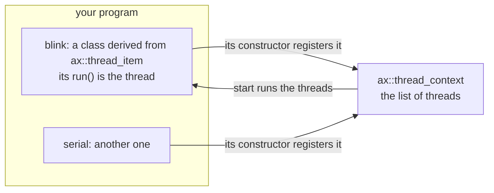
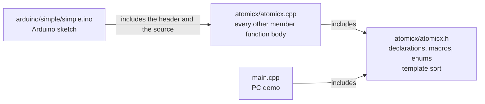
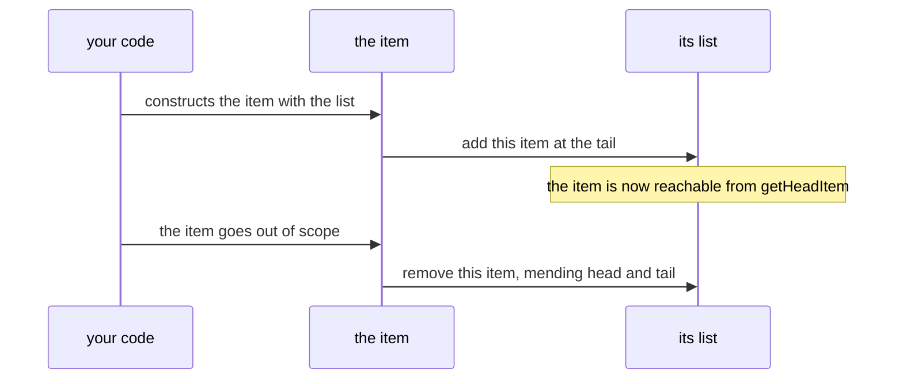
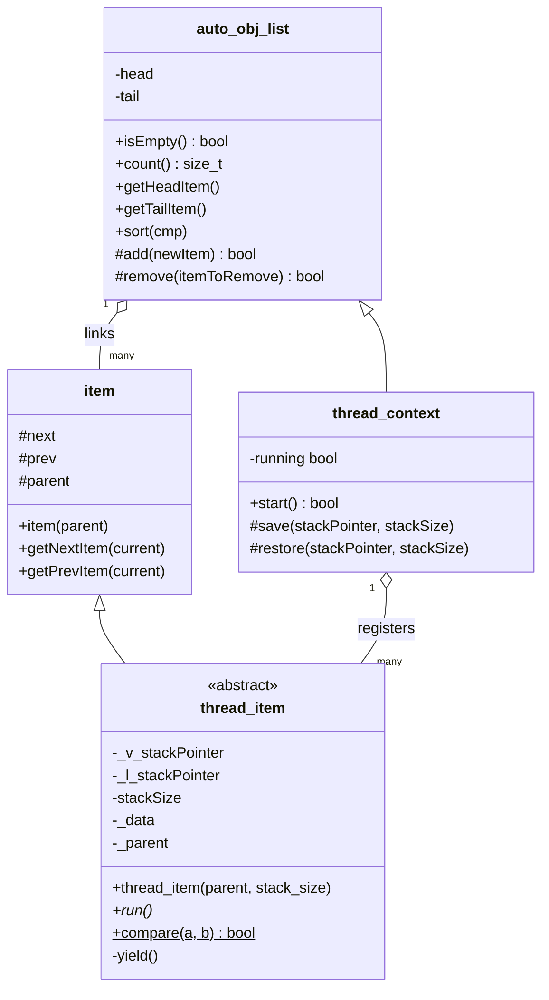
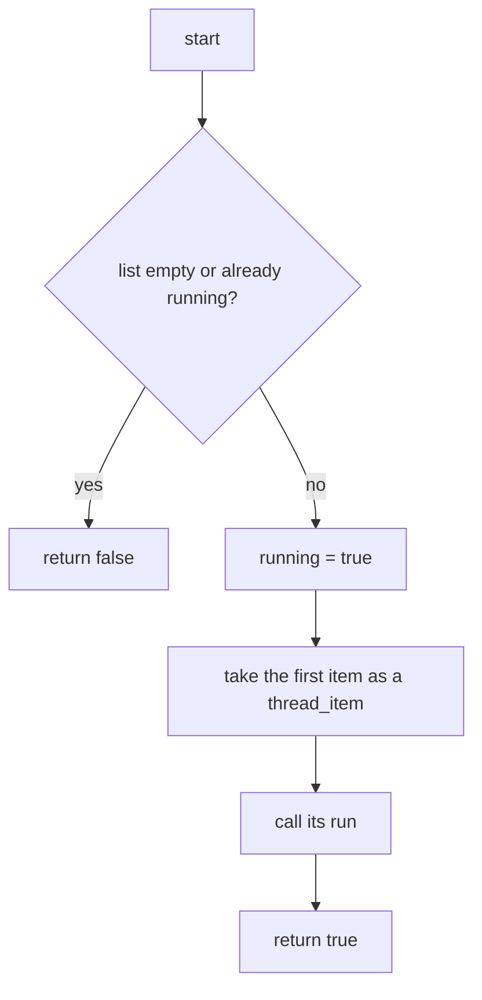
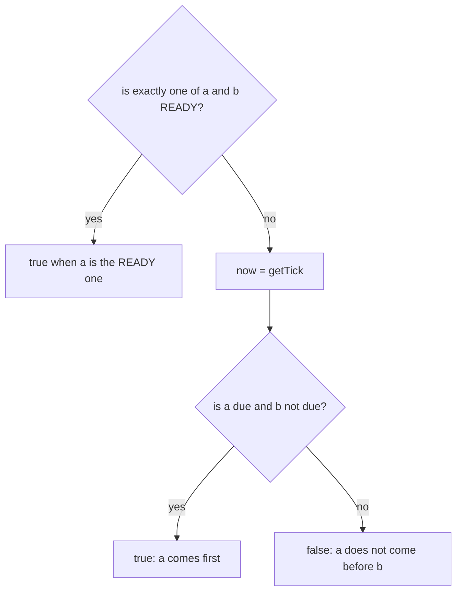
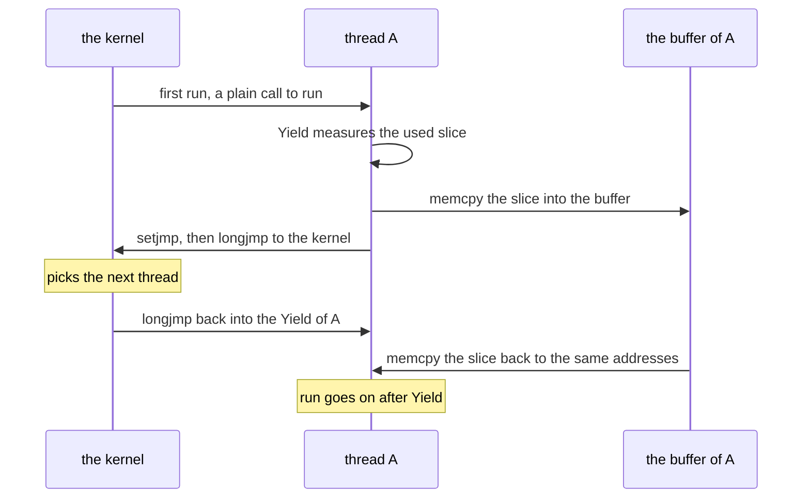

# AtomicX 2 — Specification (SDD), v2.0.0.proto

**What AtomicX 2 is.** AtomicX 2 is a C++11 library for **cooperative multithreading** on small microcontrollers
(AVR such as the Arduino Nano, ESP8266, ESP32, STM32) and on computers (Linux, macOS). *Cooperative* means a thread
runs until it gives the processor back by itself; nothing interrupts it. A thread is an ordinary object: you derive a
class from `ax::thread_item`, write its `run()`, and construct it with an `ax::thread_context`. Constructing the
object registers the thread in the context; destroying it unregisters it; nothing else has to be called. AtomicX 2 is
the successor of atomicx v1.3.0 (github.com/solariun/atomicx), whose threads switch by copying each thread's part of
the stack in and out of a buffer (§3.5).

**Status (2026-10-14): prototype, version `2.0.0.proto`, rebuilt from scratch since 2026-10-09; the last commit is
`fa67484` (2026-10-13), and the changes after it are not committed yet.** Built: the self-registering list
(`auto_obj_list`, with a stable merge sort), threads that register themselves and own a stack buffer
(`thread_item`), the schedule order that ranks them (`thread_item::compare`, applied by `yield()`), and the context
that holds them (`thread_context`), whose `start()` so far runs only the first thread, once. Not built: the
scheduler and the context switch (`save` and `restore` are empty; `yield()` only sorts), sleep (`sleepTicks` is
declared and never called), and every thread state but `READY`. Build state: `make build` fails under `-Werror`
because `thread_item::_l_stackPointer` is private and never used (P20); before Gustavo made the data private, the PC
build and the demo were clean (*measured*). For the ESP32 the library compiles, but `arduino/simple` links only in
a copy with `setup()` and `loop()` added (P3); AVR does not compile (P1). The earlier prototypes (2024) stay in the
history; the last one is commit `683195f`.

This file is normative: every change to behaviour, API, file layout or tests is recorded here first (Spec-Driven
Development, §0.3). Where this file and the code disagree, the disagreement is a defect to be resolved here first.

**Repository:** github.com/solariun/atomicx2. **Author:** Gustavo Campos. **License:** undecided (P14).

### Changelog

| Date | Change |
|---|---|
| 2024-02-25 to 2024-09-24 | **Earlier attempts** (`5fd1afe` to `969611b`): a `thread` class that registers itself on a static list (`5fd1afe`); the "first thread engine" (`09bf6dd`, 2024-02-29), in namespace `atomicx`: `setjmp`/`longjmp` with a save and a restore of the stack slice and one global context `g_ctx`; restarted on 2024-09-23 ("new version prototype started", `e1d6c12`) with `Context` and `Thread` classes (`edb369f`), each thread taking its own context and a program-given buffer of `size_t` words (`b834acc`). |
| 2024-09-24 to 2024-11-02 | **The first running prototype** (`8611af1` to `683195f`): threads switched with `setjmp`/`longjmp` and a copy of each thread's used stack slice, as atomicx v1 does; stack buffers given by the program through `VMEM`; a context per thread at first, one global context `ctx` from `9b0ea0d` (namespace `ax` from `ef0b9da`); a scheduler that ran `READY` threads first, then the sleeping thread due first (the "momentum scheduler" of `1539f25`); `wait`/`notify` keyed by a variable's address and a channel, with tags and timeouts, and a system channel 255 (`ATIMICX_SYS_CHANEL`) used inside. A PC demo and an Arduino Nano demo. |
| 2026-10-09 | **Redesign started** (`8607977`, "redesign: initial"): the implementation removed (`atomicx.cpp` reduced to its includes and an empty namespace, 351 lines deleted; 649 lines deleted over five files, the PC demo included); a new skeleton: the self-registering list `auto_obj_list`, `thread_context` objects passed to each `thread_item`, stack buffers on the heap, `enum class State`. The Arduino sketch kept the old API. The header failed `-Werror` (an unused variable). |
| 2026-10-10 | `710c462`: `Time` renamed `time` and `RefId` renamed `ref`; `getNextItem` and `getPrevItem`; the links made protected. The header did not compile (an unfinished struct in `thread_item`). |
| 2026-10-12 | `8eea8f3`: the stable merge sort `auto_obj_list::sort` (no STL, no recursion); `st_data` (`lastRunTime`, `nice`, `state`), which made the header compile again; the stack pointers renamed `_v_stackPointer` and `_l_stackPointer`; the sketch's threads, `setup()` and `loop()` removed. |
| 2026-10-13, `fa67484` | **`start()` runs the first thread** (Gustavo): `thread_context` moved after `thread_item`, hence A4; `start()` returns false when `running` is set and calls the first item's `run()` through a cast to `thread_item*` (R3.9, R3.11, P11), where at `8eea8f3` it ran nothing and returned true on every call; the comment "BY DESIGN would never return…" added (R3.10). |
| 2026-10-13, `fa67484` | **Thread construction fixed (A2, A3, A4).** `class thread_context;` is declared before `thread_item` (Gustavo), and the `thread_item` constructor is defined where `thread_context` is complete, because `item(parent)` must convert `thread_context&` to `auto_obj_list&`. The stack buffer comes from `new (std::nothrow)`, so the failure branch can run on every target; the constructor's parameter is `stack_size`, so `stackSize = 0` resets the member. Measured on the PC: a request of 2^61 bytes aborted the program (`std::bad_alloc`, exit 134) before, and is reported and survived (buffer null, `stackSize` 0, exit 0) after (§6). |
| 2026-10-13, `fa67484` | **Declarations in the header, definitions in the source (A1).** The 15 non-template member function bodies moved from `atomicx.h` to `atomicx.cpp`, in declaration order, their text unchanged (only shifted to namespace level); the template `sort` stays in the header; `#include <new>` moved with the constructor. Proof: the moved bodies byte-identical to Gustavo's working copy, `make build` clean with `-Werror`, the demo's output unchanged. Cost on the ESP32: +184 bytes with the probe sketch of §6, and +251,641 bytes of flash and +7,132 bytes of RAM in a sketch that uses nothing of AtomicX, because the out-of-line definitions bring the C++ stream library in (P17). |
| 2026-10-13, `fa67484` | **`volatile` list changes and a typed parent (A5, Gustavo).** `add` and `remove` became `volatile` member functions, `item::parent` a `volatile auto_obj_list&`, and `thread_item` gained `_parent` (`volatile thread_context&`); the stack buffer is allocated in the initializer list. The initializer list was then written in construction order (R3.1), which `-Werror` requires (`-Wreorder-ctor`). |
| 2026-10-13, `fa67484` | **`thread_item`'s data made private; `yield()` declared (A6, Gustavo).** Every data member of `thread_item` is now private, and a private `void yield()` is declared and defined empty. Since then `make build` fails under `-Werror`: `-Wunused-private-field` on `_l_stackPointer` and `_parent` (P20); `fa67484` includes this edit, although its message says that `make build` is clean. |
| 2026-10-13, `fa67484` | **This specification created** (the commit holds its first version): the code as built, the earlier history, atomicx v1's thread switch as the reference for the planned one (§3.5), and the open problems found while writing it (§7), each with the evidence given in its row. Reviewed independently the same day (claims against the code and the history, v1's citations, diagrams, tables and cross-references); its 32 findings corrected after the commit. |
| 2026-10-14 | **`st_data` initialized** (Gustavo): `lastRunTime = 0`, `nice = 1`; P6 fixed. |
| 2026-10-14 | **The schedule order, applied by `yield()` (A7, A8, Gustavo).** `thread_item::compare(a, b)`, public and static, orders a context for `auto_obj_list::sort`: `READY` threads first, then due threads (`lastRunTime + nice` not after now, wrap-safe), ties in list order. `yield()` sorts its context with it; to call `sort` through the `volatile` `_parent`, `sort` and `count` became `volatile` member functions. The library now calls `getTick()`, so a program that does not define it no longer links (R4.1). Proof (§6): the order of §3.4's example, `yield()` sorting its context, 0 violations of a strict weak ordering in 2000 random rounds, and two tick-wrap cases that fail with the naive `lastRunTime + nice <= now` and pass with the wrap-safe test; `-Werror` now trips only on `_l_stackPointer` (P20). |

### How to read this document

- Every section starts **in plain words**, often with a picture; the **exact rules** follow.
- **As built** describes the code today. **Planned** describes an intention that has no code yet; it is not normative
  for the code until it is built and this file says so.
- "Must", "never" and "always" are normative. Names in `code` are the ones in `atomicx/atomicx.h`; rules are numbered
  (R1.1 …), decisions (A1 …), open problems (P1 …).
- Values marked *measured* come from runs (§6). Every term is defined in the glossary (§8).

---

## 0. Decisions

### 0.1 The idea in one picture



**In plain words.** You never call "create thread" or "add thread". Making the object is enough: its constructor puts
it in the context's list, and its destructor takes it out. The context then runs the threads one after the other,
each one until it hands the processor back (cooperative). As built, `start()` runs only the first thread (§3.3); the
scheduler is still to be designed (§3.5).

### 0.2 Decisions

| # | Decision | In plain words: why |
|---|---|---|
| A1 | **The header declares, the source defines** (Gustavo, 2026-10-13). `atomicx.h` holds declarations, macros, type aliases, enums, data members with their default initializers, deleted and pure virtual functions, and templates with their bodies (`sort`). Every other member function is defined in `atomicx.cpp`, in the order of its declaration, its text kept as written. | Gustavo asked for the member function bodies in the source and only declarations and templates in the header, keeping the same formatting and writing structure. The interface reads in one place, and the definitions see every class complete, so the order of the classes in the header no longer matters for them (A4). Rejected: a header-only library (bodies inside the classes), by Gustavo's instruction. Not chosen, open to revisit: definitions back in the header. *Measured* on the ESP32: the split costs 184 bytes with the probe sketch of §6, and 251,641 bytes of flash and 7,132 bytes of RAM in a sketch that uses nothing of AtomicX, because the out-of-line definitions bring the C++ stream library in (P17). Making only the one-line getters `inline` would recover nothing: the sketch compiles `atomicx.cpp` inside its own unit, where they are inlined anyway. |
| A2 | **The stack buffer comes from `new (std::nothrow)`** (Gustavo, 2026-10-13). When it fails, the constructor prints `Failed to allocate stack for thread item.` to `std::cerr` and sets `stackSize` to 0; the thread stays registered. | On the PC (*measured*: exit 134) and on the ESP32 (its core builds with `-fexceptions`), plain `new` throws `std::bad_alloc` when it fails, so the old `if (!_v_stackPointer)` branch could never run there. The Arduino AVR core (the Nano, `-fno-exceptions`) returns null from plain `new` instead (`cores/arduino/new.cpp`, where `NEW_TERMINATES_ON_FAILURE` is left undefined), which the standard does not allow. `new (std::nothrow)` returns null on all three, so the failure branch is portable. Rejected: letting it throw. Open: what a thread without a buffer should do (P7), and whether the buffer should come from the program instead of the heap (P16). |
| A3 | **The constructor's parameter is `stack_size`, in words of `size_t`; the member `stackSize` is in bytes** (Gustavo, 2026-10-13). | The parameter used to be called `stackSize` too, so `stackSize = 0` on failure changed the parameter and the member kept its size (*measured*: with `new (std::nothrow)` and the old name, the member kept 2^61; with `stack_size`, 0). The parameter follows Gustavo's snake_case; the member keeps its name. Rejected: keeping the name and writing `this->stackSize = 0` (the shadowing stays a trap). |
| A4 | **`class thread_context;` is declared before `thread_item`, and the `thread_item` constructor is defined where `thread_context` is complete** (since A1: in `atomicx.cpp`). | Gustavo moved `thread_context` after `thread_item`: its `start()` calls `run()` on a `thread_item`, which needs `thread_item` complete while the body is in the class. Then `thread_item`'s constructor names `thread_context` before its definition. A forward declaration gives only the name: it cannot say that `thread_context` derives from `auto_obj_list`, and `item(parent)` needs exactly that conversion, so that body cannot sit inside the class (*measured*: "cannot convert argument of incomplete type 'thread_context' to 'auto_obj_list &'"). Rejected: `thread_context` first, as at `8eea8f3`; possible again since A1, but not needed. |
| A5 | **`add` and `remove` are `volatile` member functions; `item::parent` is `volatile auto_obj_list&`; `thread_item::_parent` (`volatile thread_context&`) keeps the context with its own type** (Gustavo, 2026-10-13). | *Reason to be recorded by Gustavo* (P19). Consequence (*measured*): through `parent` and `_parent`, only `volatile` member functions can be called (`add`, `remove`, `save`, `restore`), not `isEmpty`, `count`, `getHeadItem`, `getTailItem`, `start` or `sort`. `volatile` gives no atomicity (R2.4). |
| A6 | **`thread_item`'s data members are private, and it declares a private `void yield()`** (Gustavo, 2026-10-13). | *Reason to be recorded by Gustavo* (P19). Consequence: a class derived from `thread_item` cannot reach the buffer, `stackSize`, `_data` or `_parent`, nor call `yield()`; and `make build` fails (P20). |
| A7 | **The schedule order: `thread_item::compare(const item& a, const item& b)`** (Gustavo, 2026-10-14), public and static, for `auto_obj_list::sort`: `a` comes first when `a` is `READY` and `b` is not; when both or neither are `READY`, when `a` is due and `b` is not. A thread is due when `lastRunTime + nice` is not after now (`getTick()`), tested wrap-safe (R3.15). | Gustavo: the `READY` state is the first order; whether nice plus the last run time goes beyond now is the second. The wrap-safe test: `ax::time` is a `uint32_t` that wraps (2^32 ms is about 49.7 days), and the naive `lastRunTime + nice <= now` misorders threads around the wrap (*measured*, §6). Proposed, not built, waiting for Gustavo (P22): reading now once per sort, with a comparator object that holds it, instead of a `getTick()` per comparison; ordering due threads by due time, least recently run first, which would rotate equal threads instead of keeping the list's order. |
| A8 | **`yield()` sorts its context by the schedule order** (Gustavo, 2026-10-14): `_parent.sort(compare)`. To call `sort` through the `volatile` `_parent` (A5), `sort` and `count` are `volatile` member functions; both still work on lists that are not `volatile`. | Gustavo asked for the sort in `yield()`. Rejected: casting `volatile` away in `yield()` (`const_cast`), which is valid only because no context object is itself `volatile`, and which would bypass A5. |

### 0.3 Development standards: the definition of done

The workspace standard (Gustavo, 2026-09-27; full text in `unlimited/spec.md` §0.5, with the same numbering)
applies here:

| # | Standard | What it asks for here |
|---|---|---|
| D1 | **Spec first** | The change is written in this file before or with the code: plain words first, exact rules after, each decision with its reason and the alternatives rejected, a changelog row, every affected section. |
| D2 | **Design explained, with diagrams** | Plain language first, complete after, at least one picture (Mermaid, or SVG generated from the code). A design choice that changes behaviour is shown to Gustavo and confirmed before it is built. |
| D3 | **Proof that it works** | Tests that fail before and pass after, numbers measured before and after, every target green. Today the targets are `make build` and `make run` on the PC and an `arduino-cli compile` of `arduino/simple`; there is no `make test` yet (P13). Limits stated in §7, never hidden. |
| D4 | **Every document updated** | This file, `README.md`, the examples and the comments describe the code as it is. |
| D5 | **Clarity** | Accessible to newcomers and to C++ and embedded programmers; every term defined (§8); numbers with units, marked *measured* or *expected*. |
| D6 | **Git** | Commit and push only when Gustavo asks; the author is Gustavo Campos, with no co-author lines. |
| D7 | **Pedagogic, with pictures everywhere** | Plain words for newcomers first, depth for experts after, in the documents and in every report to Gustavo. |

---

## 1. Files and build (normative)

### 1.1 Files

**In plain words.** The library is two files. The header says *what* the library offers; the source says *how* it
works. A program compiles the source once and includes the header wherever it uses the library.



| File | Role |
|---|---|
| `atomicx/atomicx.h` | The interface (A1): the `ax` namespace, its types, the classes and the template `sort`. |
| `atomicx/atomicx.cpp` | The definitions of every non-template member function (A1). |
| `main.cpp` | The PC demo: four threads registered, listed and destroyed (§4). |
| `arduino/simple/simple.ino` | The Arduino sketch; `arduino/simple/atomicx` is a symbolic link to `../../atomicx`. |
| `Makefile` | The PC build and the Arduino targets (§1.2). |
| `README.md` | A stub with a Nano compile command (P15). |
| `bard.txt` | Prompt-and-answer notes about a self-registering C++ list and a Makefile; never built. |
| `.github/workflows/c-cpp.yml` | GitHub's autotools starter workflow; it fails (P13). |

**Exact rules.**

1. **R1.1** `atomicx.h` follows A1: a new non-template member function is declared in the header and defined in
   `atomicx.cpp`, in declaration order.
2. **R1.2** `atomicx.cpp` is compiled exactly once per program. The Makefile compiles it as its own unit
   (`SRCS = $(wildcard *.cpp) $(wildcard $(CPX_DIR)/*.cpp)`). The Arduino sketch includes it as text
   (`#include "atomicx/atomicx.cpp"`), because `arduino-cli` compiles only the sketch folder's own files and its
   `src/` folder, never `atomicx/`; the sketch therefore builds as one unit (a unity build, §8), with no duplicate
   symbols.
3. **R1.3** The PC build is `g++ -O0 -Wall -g --std=c++11 -Wall -Wextra -Werror` (the Makefile's `CFLAGS`); it must stay
   free of warnings. The code is C++11: nothing newer may be used.

### 1.2 Make targets (as built, checked 2026-10-13)

**In plain words.** `make` builds and runs the PC demo; the other targets compile the Arduino sketch and upload it to
a board, or install and run tools. The table says which ones were checked.

| Target | What it does | State |
|---|---|---|
| `make build` (the default) | Cleans, then builds `bin/demo_atomix.bin` from `main.cpp` and `atomicx/atomicx.cpp`. | Fails since A6 (P20); worked before it (*measured*). |
| `make run` | `build`, then runs the demo. | As `make build`. |
| `make debug` | `build`, then opens the demo in `lldb`. | Not checked. |
| `make nano`, `make nano_flash` | `arduino-cli compile --upload` of `arduino/simple` for the Nano (serial port or USBasp). | Fails: AVR has no `<iostream>` (P1). |
| `make nodemcu` | The same for the ESP8266 NodeMCU. | Not checked: the ESP8266 core is not installed here. |
| `make bootloader_nano`, `make install_arduino_cli` | Burn the Nano's bootloader; install `arduino-cli` and its cores with Homebrew. | Not checked. |
| `make document` | Runs `Doxygen`. | No Doxyfile in the repository (P15). |
| `make depend`, `make clean`, `make help` | `makedepend`; remove the objects and the binary; list the targets. | `clean` and `help` work. |

The ESP32 has no target in the Makefile; the sketch compiled for it with `arduino-cli compile --fqbn
esp32:esp32:esp32` once `setup()` and `loop()` were added to a copy (§6, P3).

---

## 2. The self-registering list: `ax::auto_obj_list`

### 2.1 In plain words

`auto_obj_list` is an **intrusive doubly linked list**: the links live inside the objects themselves, so the list
never allocates memory. An object joins its list when it is constructed and leaves it when it is destroyed.

```
            head                                          tail
             |                                             |
             v                                             v
        +---------+  next   +---------+  next   +---------+
null <--| item A  |-------->| item B  |-------->| item C  |--> null
        |         |<--------|         |<--------|         |
        +---------+  prev   +---------+  prev   +---------+
          every item also keeps `parent`: the list it belongs to
```



### 2.2 Exact rules (as built)

| Member | Access | Rule |
|---|---|---|
| `item(auto_obj_list& parent)` | public | Keeps `parent`, appends the item at the tail (`add`) and prints `Added item to parent list at address: <this>` to `std::cout`. |
| `item()` | deleted | An item always belongs to a list. |
| `~item()` | public | Unlinks the item (`remove`) and prints `Removed item from parent list at address: <this>`. |
| `getNextItem(item* current) const`, `getPrevItem(item* current) const` | public | Return `current->next`, `current->prev`, or `nullptr` when `current` is null. They read their argument, not `this` (P10). |
| `next`, `prev` (`item*`, default `nullptr`); `parent` (`volatile auto_obj_list&`) | protected, in `item`; `auto_obj_list` is a friend of `item` | The links, set by `add` and `remove` and rewritten by `sort`, and the list the item belongs to, bound by the constructor; visible to every class derived from `item`. |
| `isEmpty() const` | public | True when `head` is null. |
| `count() const volatile` | public | Walks the whole list: O(n). `volatile` since A8, so that `sort` can call it on a `volatile` list. |
| `getHeadItem() const`, `getTailItem() const` | public | The first and the last item, or `nullptr`. |
| `sort(Compare cmp) volatile` | public, template | §2.3. `volatile` since A8, so that `yield()` can call it through `_parent`; it still works on a list that is not `volatile`. |
| `add(item*) volatile`, `remove(item*) volatile` | protected | Append at the tail; unlink and mend `head` and `tail`. Both return false only for a null pointer. Only `item`'s constructor and destructor call them. |
| copy constructor and copy assignment of `item` and of `auto_obj_list` | public, implicit | Not declared; the compiler provides them (R2.5, R2.6). |

1. **R2.1** Items are kept in construction order (each one appended at the tail) until `sort` reorders them.
2. **R2.2** A list is walked with `for (item* i = list.getHeadItem(); i; i = i->getNextItem(i))`, as `main.cpp` does.
3. **R2.3** An item must be destroyed before its list: its destructor calls `parent.remove(this)`.
4. **R2.4** As built, `add` and `remove` take no lock and do not mask interrupts.
5. **R2.5** An item must not be copied: the implicit copy constructor copies the links without registering the copy,
   and the copy's destructor unlinks the original (*measured*, P4). The type does not prevent it for `item` and the
   classes derived from it; for `thread_item` only its `volatile` `_data` member does (R3.7).
6. **R2.6** A list must not be copied: the implicit copy constructor and copy assignment of `auto_obj_list` (and so of
   `thread_context`) copy `head` and `tail` but not the items, whose `parent` still names the original; destroying an
   item mends only the original, and the copy keeps a dangling pointer (*measured*, P21). Passing a context by value
   compiles without a warning. The type does not prevent it yet.

### 2.3 Sorting: `sort(cmp)`

**In plain words.** `sort` reorders the items by changing their links; no object is copied and no memory is taken.
You give it `cmp`, the rule that says which of two items comes first. It is a **stable** sort: two items that `cmp`
calls equal keep the order they had.

```
keys in the list:   3   1   2   1'          (1 and 1' are equal keys; 1 was constructed first)

width 1:  merge [3] with [1]      -> [1 3]      merge [2] with [1']  -> [1' 2]
width 2:  merge [1 3] with [1' 2] -> [1 1' 2 3]
                                      ^ 1 stays before 1': on a tie the left run's item is taken
```

**Exact rules.**

1. **R2.7** `cmp(a, b)` returns true when `a` must come **strictly** before `b`, like `operator<` (a strict weak
   ordering). `sort` calls it as `cmp(*right, *left)` and takes the right run's item only when it is strictly smaller,
   so `cmp` must return false for equal items, or the sort is no longer stable.
2. **R2.8** `cmp` receives the items as `auto_obj_list::item`. To reach a derived class's data it casts,
   `static_cast<const my_type&>(a)`, which is valid only when every item in that list is a `my_type`.
3. **R2.9** Bottom-up merge sort over runs of width 1, 2, 4, …: O(n log n) comparisons, O(1) extra memory, no
   recursion; one `count()` per call; the `prev` links and `tail` are rebuilt at the end.
4. **R2.10** C++11: `cmp` may be a function pointer, a functor or a lambda with typed parameters (generic lambdas are
   C++14).

*Measured* (2026-10-13): keys 3, 1, 2, 1 became 1, 1, 2, 3 with the two 1s in construction order, and `getTailItem()`
was the 3. Nothing in the repository calls `sort` yet.

---

## 3. Threads and the context

### 3.1 In plain words

A **thread** is an object of your class derived from `ax::thread_item`; its `run()` is the code the thread executes.
A **context** (`ax::thread_context`) is the list of threads that take turns on one processor. Because
`thread_context` is an `auto_obj_list` and `thread_item` is an `auto_obj_list::item`, §2 holds for them: a thread is
in its context from its construction to its destruction. One difference: a thread cannot be copied (R3.7).



`item` is a type nested in `auto_obj_list` (`ax::auto_obj_list::item`); the diagram draws it apart.

### 3.2 `thread_item` (as built)

**In plain words.** Constructing a thread does three things: it joins the context's list, it takes a stack buffer of
`stack_size` words for the thread, and it marks the thread `READY`. Destroying it gives the buffer back and leaves the
list. Its data is private (A6): a class derived from it writes `run()` and nothing else.

The order in which C++ builds the object, whatever order the initializer list is written in:

```
thread_item(ctx, stack_size)
  1. base   item(ctx)              joins ctx's list, prints "Added item to parent list at address: ..."
  2. member _v_stackPointer        new (std::nothrow) volatile size_t[stack_size]
  3. member _l_stackPointer        nullptr (default member initializer)
  4. member stackSize              stack_size * sizeof(size_t), in bytes
  5. member _data                  state = READY, lastRunTime = 0, nice = 1 (default member initializers)
  6. member _parent                ctx
  7. body   buffer null?  yes ->   std::cerr "Failed to allocate stack for thread item.", stackSize = 0
                          no  ->   std::cout ">>> Allocated stack for thread item at address: ... with size: <stack_size>"
```

**Exact rules.**

1. **R3.1** The initializer list must be written in the construction order above: the base first, then the members
   in the order of their declaration. `-Werror` turns `-Wreorder-ctor` into an error otherwise.
2. **R3.2** `stack_size` counts words of `size_t`: 8 bytes on a 64-bit PC, 4 on the ESP32, 2 on AVR. `stackSize`
   holds bytes.
3. **R3.3** When the allocation fails (A2), the thread stays registered, with `stackSize == 0` and a null buffer.
4. **R3.4** `~thread_item()` frees the buffer (`delete[]`; nothing to do when it is null), then `~item()` leaves the
   list.
5. **R3.5** `run()` is pure virtual: every thread class must define it.
6. **R3.6** A `thread_item` is constructed only with a `thread_context`; `_parent` keeps it with that type, and
   `parent` (from `item`) keeps it as an `auto_obj_list`. Both name the same object. Both are `volatile` (A5), so only
   `volatile` member functions can be called through them: `add`, `remove`, `save` and `restore`.
7. **R3.7** A `thread_item` cannot be copied: its implicit copy constructor is deleted because `volatile st_data`
   has no usable copy constructor (*measured*: "copy constructor of 'thread_item' is implicitly deleted because field
   '_data' has no copy constructor"). That protects threads from R2.5's hazard, by accident rather than by design.
8. **R3.8** `yield()` is private; it sorts the thread's context by the schedule order, `_parent.sort(compare)`
   (A8, §3.4); nothing calls it yet.

| Member | Access | Type | Meaning (as built) |
|---|---|---|---|
| `compare(a, b)` | public, static | `bool (const item&, const item&)` | The schedule order (A7, §3.4). |
| `yield()` | private | `void ()` | Sorts the context by the schedule order (A8). |
| `_v_stackPointer` | private | `volatile size_t*` | The thread's stack buffer ("virtual stack memory"), `stack_size` words. |
| `_l_stackPointer` | private | `volatile size_t*` | "Local stack memory pointer"; never set or read yet. |
| `stackSize` | private | `volatile size_t` | The buffer's size in bytes; 0 after a failed allocation. |
| `_data` | private | `volatile st_data` | `lastRunTime` (0) and `nice` (1), `ax::time`, read by `compare` and never set yet; `state` (`READY`). |
| `_parent` | private | `volatile thread_context&` | The context the thread belongs to (A5); `yield()` sorts it (A8). |

### 3.3 `thread_context` (as built)

**In plain words.** The context is the list of threads. As built, `start()` runs the first thread's `run()` once and
returns when it returns; there is no scheduler yet, and `save` and `restore` are empty.



**Exact rules.**

1. **R3.9** `start()` returns false when the list is empty or `running` is true; otherwise it sets `running`, calls
   `run()` of the first item (cast to `thread_item*`), and returns true when that `run()` returns. `running` is never
   reset, so a second `start()` returns false (*measured*: three threads, one `run()` call, then false).
2. **R3.10** The comment on `start()`, "BY DESIGN would never return. If so the system failed to start threads",
   describes the planned scheduler (§3.5), not the code as built.
3. **R3.11** Every item in a `thread_context` must be a `thread_item`: `start()` casts the first one without checking.
   The types do not enforce it (P11).
4. **R3.12** `save(stackPointer, stackSize)` and `restore(stackPointer, stackSize)` are protected, `volatile`, and do
   nothing yet. `thread_item` is a friend of `thread_context`, so `thread_item`'s own member functions may call them
   through `_parent`; a class derived from `thread_item` may not, because friendship is not inherited.

### 3.4 The schedule order: `thread_item::compare` (as built)

**In plain words.** Before a scheduler can choose who runs next, the context's threads are put in order. Ready
threads come first. Between two threads that are equally ready, the one whose time has come (its last run plus its
`nice` is not after now) comes before the one that must still wait. Threads that tie keep the order they had,
because the sort is stable. `yield()` applies this order to its own context.

```
now = 1000    state        lastRunTime + nice    due?
   A          SLEEPING        0 +   1 =    1     yes
   B          READY         995 +  10 = 1005     no, after now
   C          READY           0 +   1 =    1     yes
   D          READY         500 + 100 =  600     yes
   E          TERMINATED    999 +  50 = 1049     no, after now

sorted:   C   D   B   A   E
          C, D: ready and due (C before D: a tie keeps the list's order)
                  B: ready, not due
                      A: not ready, due
                          E: not ready, not due
```



**Ticks wrap.** `ax::time` is a `uint32_t`: at 1 ms per tick it wraps to 0 after 2^32 ms, about 49.7 days. The test
measures how far now is past the due time, modulo 2^32:

```
due  when  (now - (lastRunTime + nice)) mod 2^32  <  2^31        (k_tick_half_range)

now = 0x00000008, lastRunTime + nice = 0xFFFFFFF4:   now - due = 0x14 = 20   -> due, 20 ticks late
                  the naive lastRunTime + nice <= now:   0xFFFFFFF4 <= 8 is false   -> "not due": wrong
```

**Exact rules.**

1. **R3.13** `compare(const item& a, const item& b)` is a public static member of `thread_item`. It takes
   `auto_obj_list::item` references so that `sort` can call it (`ctx.sort(ax::thread_item::compare)`), and casts
   both to `thread_item`: every item in the list must be a thread (R3.11).
2. **R3.14** It returns true when `a` must come before `b`: `a` is `READY` and `b` is not; or both are `READY` or
   neither is, and `a` is due while `b` is not. Otherwise false. For a fixed now this is a strict weak ordering
   (*measured*, §6), as `sort` requires (R2.7).
3. **R3.15** A thread is due when `(ax::time)(now - (lastRunTime + nice)) < k_tick_half_range`, with
   `now = getTick()` and `k_tick_half_range` = 2^31, a constant of `atomicx.cpp`: its due time is at most 2^31 - 1
   ticks in the past, 24.8 days at 1 ms per tick. A due time further in the past reads as in the future.
4. **R3.16** `getTick()` is called once in each comparison of two threads that are equally ready, so now may advance
   during one sort (P22).
5. **R3.17** Threads that tie keep the list's order (`sort` is stable): after `yield()`, the first thread is the first
   `READY` due thread in the list's current order; equal threads are not rotated (P22).

### 3.5 Planned: the scheduler and the context switch (not built)

**In plain words.** The code keeps the names of a technique without its code: `save` and `restore` take a stack
pointer and a size, each thread has a "virtual" and a "local" stack pointer and a `yield()` that so far only sorts, and the header
includes `<setjmp.h>`. That is how atomicx v1.3.0 and the 2024 prototypes switch threads: every thread runs on the
one ordinary stack, and when it pauses, the part of the stack it is using is copied into its own buffer; when it
resumes, the copy goes back to the same addresses. The stack pointer never moves into the buffer, which v1 calls *zero
stack displacement*. How AtomicX 2 will do it is **not decided**: the design is shown to Gustavo and confirmed before
it is built (D2). This section records v1's way as the reference, from its code (`atomicx/atomicx.cpp` and
`atomicx/atomicx.hpp` of github.com/solariun/atomicx, tag v1.3.0).

```
        the one native stack (it grows down)
   high +-------------------------------+
        | the kernel's Start() frame    |  <- base: the address of a local in Start(), taken before run()
        +-------------------------------+
        | the thread's frames: run(),   |
        | what it calls, ... Yield()    |  the used slice: base - end + 1 bytes
        +-------------------------------+  <- end: the address of a local in Yield()
   low  |                               |
        +-------------------------------+

   pause:   memcpy(buffer, end, used)    setjmp(thread)    longjmp(kernel)
   resume:  longjmp(thread)              memcpy(end, buffer, used)    the thread goes on after Yield()
```



**v1's exact behaviour** (the reference; `file:line` in atomicx v1):

| Topic | v1 |
|---|---|
| Switch | One kernel `jmp_buf` (`atomicx.cpp:24`) and one per thread (`atomicx.hpp:1961`). A new thread starts with a plain call to `run()` from `Start()` (`atomicx.cpp:320-332`); a paused one is resumed by `longjmp` into its `Yield()` (`atomicx.cpp:340`). |
| Slice | Base: a local of `Start()` (`atomicx.cpp:324-328`); end: a local of `Yield()`; used = base − end + 1 bytes (`atomicx.cpp:370-372`). It assumes a stack that grows down and does not check it. |
| Save and restore | `memcpy` of the slice into the buffer, then `setjmp` and `longjmp` to the kernel (`atomicx.cpp:413-420`); after the kernel's `longjmp`, `memcpy` back to the same addresses (`atomicx.cpp:422-429`). No assembly anywhere. |
| Overflow | A slice larger than a fixed buffer calls `StackOverflowHandler()`, then `abort()` (`atomicx.cpp:408-409`); a self-managed buffer is reallocated with `malloc` to used + a growth step, and never shrinks (`atomicx.cpp:374-396`). |
| Buffers | From the program, as an array whose size the template constructor reads (`atomicx(T (&stack)[N])`, `atomicx.hpp:1126`), or self-managed on the heap (`atomicx(size_t nStackSize=0, int nStackIncreasePace=1)`, `atomicx.hpp:999`). |
| Scheduler | Threads in the `start` or `now` state run first, in list order; otherwise the earliest wake-up time wins, and the kernel sleeps the gap with the program's `Atomicx_SleepTick`. A plain `Yield()` sleeps `nice` ticks; an optional dynamic nice averages it with the last run time. When every live thread waits without a timeout, `Start()` returns false. |
| Time | The program defines `Atomicx_GetTick()` and `Atomicx_SleepTick()` (AtomicX 2's `getTick` and `sleepTicks`). Deadlines are absolute `uint32_t` values compared with `<` and `>=`: a 1 ms tick wraps after 2^32 ms, about 49.7 days, and v1 does not handle it. |
| States | Nine; no terminated state: when `run()` returns, the thread starts again unless `finish()` deletes it. Closest to AtomicX 2's `State`: `READY` ≈ start or now, `RUNNING` ≈ running, `SLEEPING` ≈ sleep or a timed wait; `TERMINATED` has no counterpart. |
| Rule for programs | A thread must never hand the address of something on its stack to another thread: while it is paused, that memory holds another thread's data (v1 README: "DO NOT USE STACK ADDRESS TO COMMUNICATE"). |

**AtomicX 2's names and their v1 counterparts.**

| AtomicX 2 (as declared) | v1 | Note |
|---|---|---|
| `thread_context::start()` | `atomicx::Start()`, the kernel loop | v1's returns only when no thread can run. |
| `thread_item::yield()` | `atomicx::Yield()` | Private in AtomicX 2 (A6); so far it only sorts the context (A8). |
| `thread_item::compare` | `SelectNextThread()`: `start` or `now` threads first, in list order, then the earliest wake-up | AtomicX 2 ranks `READY` first, then due first, and does not order by wake-up time (A7, P22). |
| `save(stackPointer, stackSize)`, `restore(…)` | the two `memcpy` of `Yield()` | Empty in AtomicX 2. |
| `_v_stackPointer`, `stackSize` | `m_stack`, `m_stackSize` | v1's template constructor stores the element count in `m_stackSize` and compares it with a byte count: exact only for byte arrays, which every v1 example uses. AtomicX 2 counts words and stores bytes (R3.2). |
| `_l_stackPointer` | — | v1 keeps the slice's two ends (`m_pStaskStart`, `m_pStaskEnd`). |
| `st_data::nice`, `lastRunTime` | `nice`, the run time of dynamic nice | |
| `getTick()`, `sleepTicks()` | `Atomicx_GetTick()`, `Atomicx_SleepTick()` | Renamed. |
| `VMEM`, `ATIMICX_SYS_CHANEL` | — | From the 2024 prototype, not from v1 (§5). |

**What the design must decide** (questions, not decisions): where the buffers come from (the heap, as built, or the
program, P16); what an overflow does; whether `run()` returning ends the thread (`TERMINATED`) or starts it again;
how ticks wrap; and how a thread waits for another (the 2024 prototype's `wait`/`notify`).

---

## 4. What the program provides

**In plain words.** The library does not know how to read a clock or how to wait on your hardware, so the program
gives it two functions. As built, the library calls `getTick()` in the schedule order (§3.4) and never calls
`sleepTicks()`.

| Function | Contract | `main.cpp` (PC) | `simple.ino` (Arduino) |
|---|---|---|---|
| `ax::time ax::getTick()` | The current time in ticks (`ax::time` is `uint32_t`). | Milliseconds from `gettimeofday`, after a `usleep(10000)` ("10ms slow dow to simulate a real system"). | `millis()` |
| `void ax::sleepTicks(ax::time nsleep)` | Wait `nsleep` ticks. | `usleep(nSleep * 1000)` | `delay(nSleep)` |

1. **R4.1** Every program must define both functions in namespace `ax`, once; since A7 a program without `getTick()`
   does not link (*measured*).
2. **R4.2** The tick's unit is the program's choice; both examples use milliseconds.

The demo (`main.cpp`, *measured* before A6): four `MyThreadItem` objects of 250 words are constructed with a global
`thread_context`, listed with `getHeadItem` and `getNextItem`, and destroyed in reverse order; it prints 4 "Added…",
4 "Allocated stack…", 4 "Thread item at address…" and 4 "Removed…" lines and exits with 0. It does not call
`start()`. After A8, built without `-Werror` (P20), the output is the same.

---

## 5. Declared, not used yet

**In plain words.** These names are in the code, but nothing uses them yet: most are left from the 2024 prototype,
or wait for the scheduler that is still to be designed (§3.5).

| Name | Where | As built |
|---|---|---|
| `class thread;` | header | A forward declaration with no definition; the 2024 prototype's thread class. |
| `ATIMICX_SYS_CHANEL` | macro, 255 | Never used. In the 2024 prototype, the channel `wait` and `notify` used inside: `wait()` first signalled on it, and a `notify()` with a timeout that found no waiter waited on it, within that timeout, for one. v1 has no channels. |
| `ATOMIC_VERSION_LABEL` | macro | `"AtomicX v" ATOMICX_VERSION " built at " __TIMESTAMP__`; never used. |
| `VMEM(vmemory)` | macro | Expands to `vmemory[0], sizeof(vmemory) / sizeof(size_t)`: an array's first element and its size in words, the arguments of the 2024 prototype's thread constructor. Never used: the constructor allocates the buffer (A2). |
| `ax::ref` | type alias | `size_t`; `RefId` before `710c462`, the 2024 prototype's key type for `wait`/`notify`. Never used. |
| `State::RUNNING`, `SLEEPING`, `TERMINATED` | enum | Only `READY` is used, as the initial state. |
| `st_data::lastRunTime`, `st_data::nice` | thread data | Initialized to 0 and 1 and read by `compare`; never set. |
| `thread_item::_l_stackPointer` | thread data | Never set or read. |
| `thread_item::stackSize` | thread data | Set by the constructor (0 after a failed allocation), never read. |
| `thread_item::yield()` | member function | Private; sorts the context; never called. |
| `sleepTicks` | free function | Defined by the programs (§4), never called by the library (`getTick` is called by `compare`). |
| `thread_context::save`, `restore` | member functions | Empty, never called. |
| `LOGGING` | macro in `atomicx.cpp` (PC only) | Defined as 0, never read. |
| `#include <setjmp.h>` | header | Included twice; nothing uses it yet. |

---

## 6. Validation evidence

All runs on 2026-10-13: macOS with Apple clang 21 (the Makefile's `g++`); the ESP32 with `arduino-cli`, core esp32
3.3.7 (xtensa GCC 14.2), `--fqbn esp32:esp32:esp32`; AVR with core arduino:avr 1.8.7 (avr-gcc 7.3).

| What | Before | After |
|---|---|---|
| `thread_item` constructor with a forward-declared `thread_context` (A4) | does not compile: "cannot convert argument of incomplete type 'thread_context' to 'auto_obj_list &'" | compiles |
| Allocation failure on the PC: a thread asking for 2^58 words, 2^61 bytes (A2) | aborts: `std::bad_alloc`, exit 134 (the code of commit `8eea8f3`) | "Failed to allocate stack for thread item.", buffer null, `stackSize` 0, exit 0 |
| Parameter shadowing (A3): the same request with `new (std::nothrow)` and the parameter still named `stackSize` | the member `stackSize` keeps 2^61 after the failure | 0 |
| Header and source split (A1): the 15 moved bodies against Gustavo's working copy before the split | — | 15 of 15 identical after the uniform shift to namespace level (the constructor apart from A2 and A3). Against commit `8eea8f3`, 13 of 15: `start()` had changed before the move |
| Symbols after the split (A1, `nm`) | — | the 15 moved functions defined (`T`) in `atomicx.o` only; `main.o` defines none of them and refers (`U`) to the 4 it uses: the `thread_item` constructor and destructor, `getHeadItem` and `getNextItem` |
| The PC demo (§4), before A6 | — | 4 "Added…", 4 "Allocated stack…", 4 "Thread item at address…" and 4 "Removed…" lines; exit 0 |
| `sort` (§2.3) | — | keys 3, 1, 2, 1 → 1, 1, 2, 3, the equal keys in construction order; tail correct |
| ESP32, the probe sketch below, `--warnings all` (A1 alone: the same code with the bodies in the header, then in the source) | 522,005 bytes of flash, 29,280 bytes of RAM, no warning from AtomicX | 522,189 bytes (+184), 29,280 bytes, no warning from AtomicX |
| ESP32, `simple.ino` with an empty `setup()` and `loop()` (A1 alone) | 265,568 bytes of flash, 22,060 bytes of RAM; 3 stream-library symbols in the image | 517,209 bytes (+251,641), 29,192 bytes (+7,132); no AtomicX code left in the image, 434 stream-library symbols, pulled in by the sketch object's references to `std::cout` and `std::cerr` |
| AVR (Nano): the sketch as it is | `fatal error: iostream: No such file or directory` | the same (P1) |
| Construction order (A5, R3.1) | `make build`: "field '_parent' will be initialized after base 'item'" (`-Werror`) | `make build` clean; the demo's output unchanged |
| Private data (A6) | `make build` clean | fails: "private field '_l_stackPointer' is not used" and "private field '_parent' is not used" (`-Werror,-Wunused-private-field`) (P20) |
| `start()` with three threads (§3.3) | — | one `run()` call, then `true`; a second `start()` gives `false` |
| Copying (R2.5, R2.6, R3.7) | — | a copied `item` unlinks the original (3 visible, then 2 while it still exists); a copied context keeps a pointer to a destroyed thread; copying a thread does not compile |
| The schedule order (A7), §3.4's example: five threads at now = 1000 | — | C D B A E |
| `yield()` sorts its context (A8): A (`READY`, 995 + 10), B (`READY`, 0 + 1), C (`READY`, 10 + 1) at now = 1000, then `A.yield()` | — | B C A |
| Tick wrap (A7): at now = 0xFFFFFFF8, X due 24 ticks ahead, past the wrap, and Y due; at now = 0x8, Q due 8 ticks ahead and P due 20 ticks ago, before the wrap | the naive `lastRunTime + nice <= now`: X Y and Q P, both wrong | the wrap-safe test: Y X and P Q |
| Strict weak ordering (A7): 2000 rounds of 6 random threads (4 states, due times around now); irreflexivity, asymmetry, transitivity and transitive ties over every pair and triple, and every sorted list | — | 0 violations |
| A program that does not define `getTick()` (R4.1) | links | `Undefined symbols: ax::getTick()`, referenced from `thread_item::compare` |
| `-Werror` after A8 | `_l_stackPointer` and `_parent` unused | `_l_stackPointer` only (P20) |
| ESP32, the probe sketch, code after A8, `--warnings all` | — | 522,313 bytes of flash, 29,288 bytes of RAM, no warning from AtomicX |

The probe sketch is `arduino/simple/simple.ino` with this added:

```cpp
ax::thread_context ctx;

struct probe_item : ax::thread_item
{
    probe_item(ax::thread_context& c) : thread_item(c, 64) {}
    void run() override {}
};

probe_item probe_a(ctx);
probe_item probe_b(ctx);

bool keep_order(const ax::auto_obj_list::item& a, const ax::auto_obj_list::item& b)
{
    (void)a;
    (void)b;
    return false;
}

void setup()
{
    ctx.sort(keep_order);
    Serial.println((unsigned)ctx.count());
    ctx.start();
}

void loop()
{
}
```

There is no automated test in the repository yet: these runs were made by hand, outside it (P13).

---

## 7. Open problems

Each problem was found while writing this file; its evidence column says how it was checked (a run, the compiler,
the history, or reading the code). None is fixed yet.

| # | Problem | Evidence | Consequence |
|---|---|---|---|
| P1 | The library writes to `std::cout` and `std::cerr`, and the header includes `<iostream>`. | avr-gcc: `atomicx.h: fatal error: iostream: No such file or directory`; on the ESP32 the stream library costs 251,641 bytes of flash and 7,132 bytes of RAM (§6, the empty sketch). | Nothing builds for AVR (the Nano), and the ESP32 pays a quarter of a megabyte for logging. |
| P2 | `atomicx.cpp` includes `<iostream>` only when `ARDUINO` is not defined; on Arduino it gets it through the header. | The include block of `atomicx.cpp`. | Taking `<iostream>` out of the header, as P1 will need, breaks every Arduino build while `make build` stays green. |
| P3 | `arduino/simple/simple.ino` has no `setup()` and no `loop()` (removed in `8eea8f3`). | ESP32 link: `undefined reference to setup()` and `loop()`. | The sketch does not link. |
| P4 | `item`, and every class derived from it except `thread_item`, can be copied: the implicit copy constructor copies the links without registering the copy, and the copy's destructor unlinks the original. | clang: "definition of implicit copy constructor for 'item' is deprecated because it has a user-provided destructor"; *measured*: 3 items visible, 2 after the copy's destruction, the original still alive. | An object copied by mistake silently disappears from its list. Threads are protected only by accident (R3.7). |
| P5 | `thread_item` has a virtual `run()` but no virtual destructor, and neither has `item`. | clang `-Wnon-virtual-dtor`. | Deleting a thread through a base pointer is undefined behaviour. |
| P6 | *Fixed on 2026-10-14 by Gustavo* (`lastRunTime = 0`, `nice = 1`): `st_data::lastRunTime` and `nice` had no initializer. | The declaration of `st_data`. | They were indeterminate for a thread on the stack or the heap, and 0 for a global thread. |
| P7 | A thread whose buffer allocation failed stays registered, with no buffer. | A2, R3.3. | `start()`, or the planned scheduler, would run it. |
| P8 | No scheduler: `start()` runs the first thread once and returns; `save` and `restore` are empty, and `yield()` only sorts. | §3.3, *measured*. | The library does not multitask yet. |
| P9 | The "Allocated stack" line prints the buffer's address as `1`. | The demo's output. Before C++23, `operator<<` has no overload for a `volatile` pointer, so the pointer converts to `bool`. | A misleading log. |
| P10 | `getNextItem(current)` and `getPrevItem(current)` read their argument, not `this`. | Their definitions. | `a->getNextItem(b)` returns `b`'s neighbour: an unusual interface. |
| P11 | A plain `auto_obj_list::item` can be registered in a `thread_context`. | `ax::auto_obj_list::item x(ctx);` compiles and is counted. | `start()` would treat it as a `thread_item`: undefined behaviour. |
| P12 | `main.cpp`'s `FAKE_TIMER` branch does not compile, and its `sleepTicks` never returns for any `nSleep` but 0. | With `-DFAKE_TIMER`: "use of undeclared identifier 'nCounter'"; `while (nSleep);`. | That branch is unusable. |
| P13 | No test target, and the CI fails. | No `make test`; `.github/workflows/c-cpp.yml` is GitHub's autotools starter (`./configure`, `make check`, `make distcheck`), none of which exists; its runs for `8607977`, `710c462` and `8eea8f3` all failed. | D3's "tests that fail before and pass after" cannot live in the repository yet. |
| P14 | No license is settled. | `atomicx.h` and `atomicx.cpp` say MIT (since `42b2515`); the Makefile's header copies the GNU GPL v3 title and preamble and points to a LICENSE file; no LICENSE or COPYING file exists anywhere in the history. atomicx v1 has an MIT LICENSE file. | Users cannot know which license applies. |
| P15 | `make document` runs `Doxygen` with no Doxyfile; `README.md` is a stub whose one command uses the path `simple`, which is `arduino/simple` from the repository's root. | The Makefile; `README.md`. | No generated documentation; the README's command fails as written. |
| P16 | The stack buffer comes from the heap (`new`). | A2. The 2024 prototype takes buffers from the program (`VMEM`); v1 takes them from the program, or self-managed from the heap, where `Yield()` frees the buffer and `malloc`s a larger one whenever the slice outgrows it (§3.5). | On an AVR, heap use at run time risks fragmentation; where the buffers come from is open. |
| P17 | A1 made the constructors, the destructors, `add`, `remove` and `start` out-of-line functions that refer to `std::cout`. | *measured* (§6): +184 bytes with the probe sketch; +251,641 bytes of flash and +7,132 bytes of RAM with an empty sketch. | A program that includes AtomicX and uses none of it pays for the stream library; solving P1 removes the cost. |
| P18 | `.vscode/settings.json` is tracked although `.gitignore` ignores `.vscode`; it holds machine-specific paths. | `git ls-files`; the file. | Editor settings of one machine travel with the repository. |
| P19 | The reasons for A5 and A6, and the alternatives Gustavo rejected, are not recorded. | A5, A6. | What `volatile` on `add`, `remove`, `parent` and `_parent` must guarantee is unclear (it gives no atomicity, R2.4), and so is how a thread will reach its own data and `yield()`. |
| P20 | `make build` fails since A6: `_l_stackPointer` is private and never used (`_parent` was too, until A8). | `-Werror,-Wunused-private-field` (§6). | The PC demo does not build. |
| P21 | `auto_obj_list`, and so `thread_context`, can be copied (R2.6). | *measured*: a context passed by value compiles without a warning; after a copy, destroying a thread leaves the copy's `head` pointing at it. | A context copied by mistake holds dangling pointers. |
| P22 | A7's two proposals wait for Gustavo: reading now once per sort, and ordering due threads by due time. | A7. | As built, `getTick()` runs once per comparison (the PC demo's sleeps 10 ms each time), now may move during one sort, and equal threads are not rotated: the first `READY` due thread in list order always comes first. |

---

## 8. Glossary

- **Context** — an `ax::thread_context`: the threads that take turns on one processor.
- **Context switch** — saving one thread's state and restoring another's, so that the second goes on where it
  stopped.
- **Cooperative multithreading** — threads take turns on one processor, and each one gives the processor back by
  itself; nothing preempts it.
- **Due** — a thread whose `lastRunTime + nice` is not after now, tested wrap-safe (§3.4).
- **Intrusive list** — a linked list whose links are members of the listed objects; it never allocates.
- **Kernel** — in atomicx v1, the code in `Start()` that picks the next thread and switches to it.
- **Nice** — in atomicx v1, how many ticks a thread sleeps when it yields without saying how long.
- **ODR (one definition rule)** — a non-inline function must be defined exactly once in a program; R1.2 keeps it.
- **Schedule order** — the order `thread_item::compare` gives a context: `READY` threads first, then due threads, ties
  in list order (§3.4).
- **Scheduler** — the code that chooses which thread runs next and switches to it; not built yet (§3.5, P8).
- **Self-registering object** — an object whose constructor adds it to a list and whose destructor removes it.
- **setjmp / longjmp** — the C library pair that saves the processor's registers at a point (`setjmp`) and later jumps
  back to it (`longjmp`); atomicx v1 switches threads with them.
- **Stable sort** — a sort that keeps equal elements in the order they had.
- **Stack buffer** — the memory a thread owns for its stack (`_v_stackPointer`, `stackSize` bytes).
- **Stack slice** — the part of the stack a thread is using when it pauses: from the kernel's frame down to the frame
  of the call that paused.
- **Strict weak ordering** — the rules of a "less than": never `a < a`; if `a < b` then not `b < a`; transitive; and
  "neither is less" behaves as equality.
- **Thread** — an object of a class derived from `ax::thread_item`; its `run()` is the code it executes (§3.1).
- **Tick** — the unit of `ax::time`, chosen by the program (§4).
- **Unity build** — compiling several source files as one by including them as text, as the Arduino sketch does with
  `atomicx.cpp` (R1.2).
- **Yield** — a thread handing the processor back by itself so that another can run; atomicx v1's `Yield()`, and
  AtomicX 2's `thread_item::yield()`, which so far only sorts the context (§3.4, §3.5).
- **Zero stack displacement** — atomicx v1's term: the stack pointer never moves into a thread's buffer; the buffer
  only holds a copy of the slice while the thread is paused.
